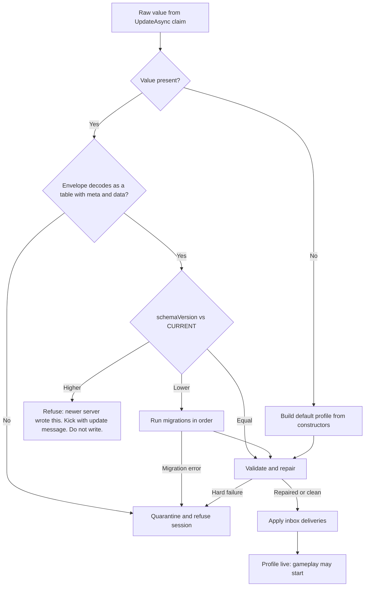

# Data Validation and Migration

How a stored profile is brought up to the current schema, checked, repaired and, when it cannot be trusted, quarantined. The storage layout is in [[Data Architecture Overview]]. Saving and failure handling are in [[Save, Load and Recovery]].

> [!info] PROPOSED
> The whole pipeline on this page is **PROPOSED**. All code is illustrative Luau and has not been executed.

## 1. Versioning model

| Item | Rule (PROPOSED) |
|---|---|
| `data.schemaVersion` | Integer, starts at `1` for the first external test build. Incremented by exactly 1 for every change to the shape or meaning of stored data. |
| `CURRENT_SCHEMA_VERSION` | Constant in the data configuration module ([[Configuration Modules]]). |
| Migrations | One function per step `n → n+1`, kept forever in an ordered table. Never edit a migration that has shipped. Fix forward with a new one. |
| Store generation (`_v1`) | Changes only if the envelope format becomes incompatible. Requires a bulk copy job and is treated as a release-level event. |
| Downgrades | Never. A server whose `CURRENT_SCHEMA_VERSION` is lower than the stored version must not load the profile (see §5, rule H3). |
| Config versions | Separate from schema versions. Tuning values (odds, prices) are versioned in config and referenced by `oddsVersion`, not by `schemaVersion` ([[Balancing Methodology]]). |

What does and does not need a migration:

| Change | Migration needed? | Notes |
|---|---|---|
| New optional field with a default | Yes (cheap) | The migration writes the default so the validator can treat the field as required afterwards |
| Rename or move a field | Yes | Copy, then delete the old key in the same step |
| New enum value (for example a new `obtainedVia`) | Yes | Bump so older servers refuse newer data (H3) instead of rejecting the unknown value as corruption |
| New species, region or module added in config | No | Content IDs are validated against config; new ones are simply valid |
| Species removed from config | Yes | Decide per case: convert, refund or keep as `orphaned`. Never delete silently. |
| Tuning change (stat, price, odds) | No | Derived values are recomputed. Odds changes are governed by [[Balance Update Process]]. |

## 2. Load pipeline



Every step is pure: it takes a table and returns a table plus a list of findings. Nothing is written to the profile store until the pipeline has finished and the session lock is held. Migrated data is persisted by the next normal save.

## 3. Migration functions

```lua
-- Illustrative Luau, not executed.
local Migrations = {}

-- Each entry upgrades version n to n + 1. Index = source version.
Migrations[1] = function(data)
	-- v1 -> v2 (example): add the user-set protection lock to animals.
	for _, animal in data.animals.instances do
		if animal.userLocked == nil then
			animal.userLocked = false
		end
	end
	return data
end

Migrations[2] = function(data)
	-- v2 -> v3 (example): rename base.vaultSteps to base.storage.vaultExpansionSteps.
	data.base.storage = data.base.storage or {}
	if data.base.vaultSteps ~= nil then
		data.base.storage.vaultExpansionSteps = data.base.vaultSteps
		data.base.vaultSteps = nil
	end
	return data
end

local CURRENT_SCHEMA_VERSION = 3

local function migrate(data): (boolean, any)
	local version = data.schemaVersion
	if type(version) ~= "number" or version < 1 or version % 1 ~= 0 then
		return false, "invalid schemaVersion"
	end
	if version > CURRENT_SCHEMA_VERSION then
		return false, "newer schema"
	end
	while version < CURRENT_SCHEMA_VERSION do
		local step = Migrations[version]
		if step == nil then
			return false, `missing migration {version}`
		end
		local ok, result = pcall(step, data)
		if not ok then
			return false, `migration {version} failed: {result}`
		end
		data = result
		version += 1
		data.schemaVersion = version
	end
	return true, data
end
```

Rules for writing a migration:
1. **Deterministic and offline**: no yields, no DataStore calls, no `os.time()` dependence other than for defaults that are clearly marked.
2. **Defensive**: assume any field may be missing or of the wrong type in old data. Leave detection to the validator; never crash on `nil` indexing (`data.base.storage or {}`).
3. **Idempotent where possible**: running a step twice on already-migrated data must not corrupt it. This protects against a save landing between two partial runs.
4. **Tested with fixtures**: every migration ships with at least three fixture profiles (fresh, typical, edge case) and a golden output. See [[Test Cases - Persistence]].
5. **Logged**: the pipeline records `fromVersion`, `toVersion` and duration through [[Logging and Error Handling]].

## 4. Validation and repair

Validation runs after migration on **every** load and also, in debug builds, after every transaction (cheap invariant checks only). Each schema page lists its own invariants. The validator classifies each finding:

| Class | Meaning | Action | Examples |
|---|---|---|---|
| **R — Auto-repair** | Safe to fix deterministically. No player value is lost. | Fix, log at info level, count in analytics | Recompute `locks.equipped` from the team. Clear stale intra-profile `pendingTx` locks. Clamp `level` to 1–100. Drop a team slot pointing at an animal the player no longer owns. Fill a missing optional field with its default. |
| **S — Soft failure** | Data is odd but playable. A human should look. | Keep the value, flag `data.flags.needsReview = true`, log at warning level | Over-capacity egg storage. Unknown content ID (species removed from config) kept with `orphaned = true`. Cash above the cap. Unknown keys preserved under `_unknown`. |
| **H — Hard failure** | The profile cannot be trusted. | Quarantine (§6), refuse the session | H1 root not a table. H2 `schemaVersion` invalid. H3 `schemaVersion` newer than this server. H4 migration error. H5 duplicate instance ID across animals and eggs. H6 collection is not a table. H7 more than 3 team slots or a non-string slot value. |

> [!danger] Repairs must never create value
> A repair may move, relabel or block an item. It must never mint Cash, eggs or animals. Any rule that would add value (for example "refund a removed species") is a migration reviewed by the economy owner, not a validator repair.

Repair order matters, because later checks depend on earlier ones:

1. Structural types (root sections exist and are tables).
2. Scalar ranges and enums (levels, ascension 0–5, rarity names, locations).
3. Content references against config (species, regions, bosses, modules).
4. Identity: every instance ID is unique across `animals` and `eggs` (H5 if not).
5. Cross-references: team slots → animals, guards → animals, displayed trophies → defeated bosses.
6. Derived lock flags recomputed from their authorities (team, guard list).
7. Capacities (egg storage, owned-animal cap): soft failure only. Never delete to fit.
8. Pending transactions: intra-profile locks are cleared (R). Cross-profile locks (`raid:` prefix) are left for the inbox and ledger reconciliation ([[Save, Load and Recovery]]).

```lua
-- Illustrative Luau, not executed.
export type Finding = { class: "R" | "S" | "H", code: string, path: string, detail: string? }

local function validateTeam(data, findings: { Finding })
	local seen = {}
	for _, key in { "slot1", "slot2", "slot3" } do
		local id = data.team[key]
		if id ~= nil then
			if type(id) ~= "string" then
				table.insert(findings, { class = "H", code = "TEAM_SLOT_TYPE", path = `team.{key}` })
			elseif data.animals.instances[id] == nil or seen[id] then
				data.team[key] = nil -- unknown or duplicate reference: safe to clear
				table.insert(findings, { class = "R", code = "TEAM_SLOT_CLEARED", path = `team.{key}`, detail = id })
			else
				seen[id] = true
			end
		end
	end
	-- Recompute the denormalised flag from the authority.
	for id, animal in data.animals.instances do
		animal.locks.equipped = seen[id] == true
	end
end
```

## 5. Rolling updates and mixed server versions

During a release, old and new servers run at the same time. A player can move from a new server (which migrated their profile to version *n+1*) to an old one.

| Rule | Behaviour |
|---|---|
| H3 newer data on an older server | The old server refuses the session without writing, shows "an update is rolling out, please rejoin", and logs `SCHEMA_AHEAD`. It must not release or change the lock either: it never claimed it. |
| Forward-compatible deploy | Ship schema changes in two releases when possible: release A teaches servers to **read** the new shape, release B starts **writing** it. This shrinks the H3 window to almost nothing. |
| Shutdown of old servers | Use the platform's update-and-restart flow so old servers drain. Our [[Save, Load and Recovery]] shutdown path saves every profile. |

## 6. Quarantine

Quarantine protects a damaged profile from being overwritten by a default one, which would turn a recoverable problem into permanent loss.

1. Copy the raw value (as read, before migration) and the findings list into `Quarantine_v1` under `u_<UserId>/<unixTime>`.
2. Do **not** write to `PlayerProfile_v1`. Release the session lock with a minimal `UpdateAsync` that only touches `meta.session`.
3. Kick the player with a support code (for example `DATA-Q-<short hash>`) and a calm message: their progress is safe and under review.
4. Raise a live-ops alert. A support engineer repairs the copy with tooling, validates it, writes it back with `UpdateAsync` while no session holds the lock, and marks the quarantine record resolved.
5. If more than a small share of joins hit quarantine after a release (alert threshold PROPOSED at 0.1% of joins in 15 minutes), halt the rollout. This almost always means a bad migration, not bad data.

> [!warning] UNDECIDED
> How long quarantine, audit and ledger records are retained, and how they are handled under a right-to-erasure request, is **UNDECIDED** (Q-955).

## 7. Test hooks

| Hook | Purpose |
|---|---|
| `DataService.Debug.loadFixture(name)` | Load a fixture profile into a test server without touching live stores |
| `Validator.run(data)` returning findings | Unit-testable without Roblox services |
| Migration golden tests | Fixture in, expected table out, for every step and for the full chain from version 1 |
| Fuzzing | Randomly delete or retype fields in a valid profile and assert that the validator never throws and never returns a profile with more value than the input |

See [[Test Cases - Persistence]] and [[Test Plan Matrix]].

## Related documents
- [[Data Architecture Overview]]
- [[Save, Load and Recovery]]
- [[Schema - Player Profile]]
- [[Service - DataService]]
- [[Configuration Modules]]
- [[Versioning and Changelog Policy]]
- [[Logging and Error Handling]]
- [[Data and Balancing Index]]
