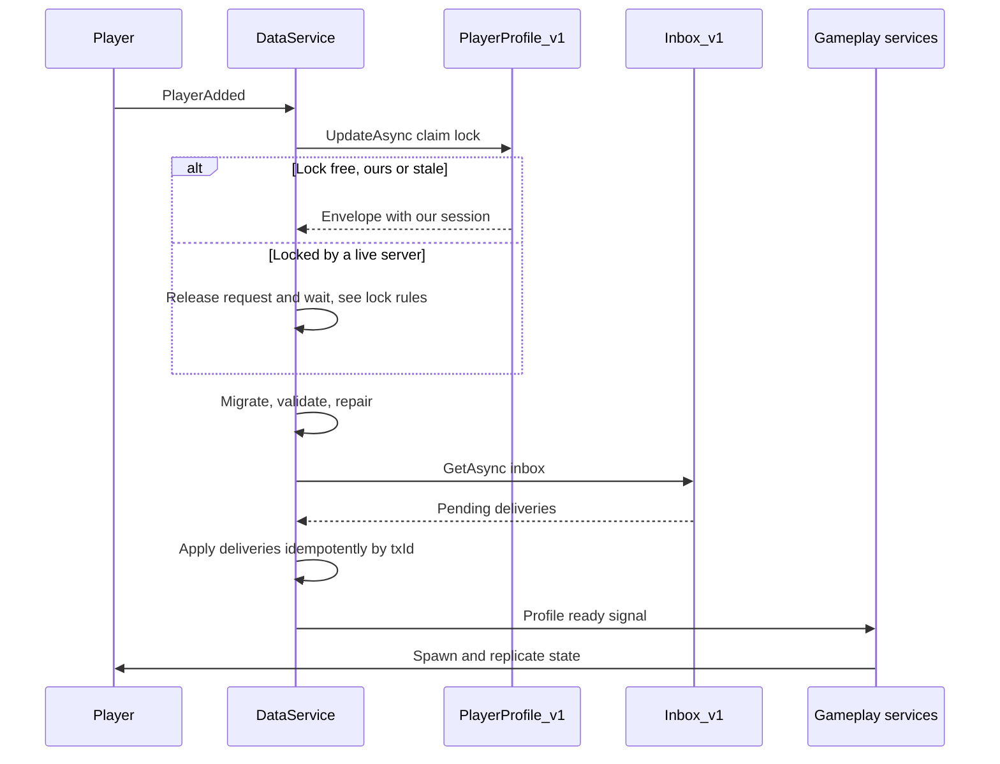

# Save, Load and Recovery

The runtime behaviour of persistence: when profiles are loaded and saved, how the server survives DataStore throttling and outages, how session locks are stolen safely, how Robux purchases are made idempotent, and how data is rolled back and recovered. Store layout and the session-lock record are defined in [[Data Architecture Overview]]. The load pipeline's migration and validation stages are in [[Data Validation and Migration]].

> [!info] PROPOSED
> All cadences, thresholds and retry counts here are **PROPOSED** and should be confirmed in load tests ([[Test Cases - Persistence]]). Roblox limits quoted here are *unverified* and must be checked against current official documentation before implementation ([[Roblox API Reference Notes]]).

## 1. Values used on this page (PROPOSED)

| Value | Proposal | Reason |
|---|---|---|
| Autosave interval | 90 s per profile, ±15 s random jitter | Bounds progress loss to about 1.5 min. Jitter spreads writes across the minute. |
| Minimum gap between writes to one key | 7 s | Stays above the per-key write cooldown, believed to be 6 s (*unverified*) |
| Critical-save debounce | Coalesce critical saves for up to 2 s, then write (respecting the 7 s gap) | A ×5 hatch should cause one write, not five |
| Session lock stale threshold | 300 s since `heartbeatAt` | About three missed autosaves |
| Lock release wait on join | Poll every 7 s for up to 30 s after a release request; give up after 60 s in total | See [[Data Architecture Overview]] §4 |
| Retry backoff | 1, 2, 4, 8, 16 s, each plus 0–0.5 s jitter | Exponential with jitter |
| Retries: join load | 5 attempts | Then kick with a "data unavailable" message |
| Retries: leave save | 5 attempts | Then log critical; lock goes stale |
| Retries: autosave | 1 attempt per cycle | The next cycle is the retry |
| Shutdown internal deadline | 25 s | Leaves margin inside the `BindToClose` window, believed to be 30 s (*unverified*) |
| Audit buffer flush | With each autosave; one chunk of at most 64 KiB per flush | Keeps audit writes at roughly one per autosave |
| Receipt ring size | Last 100 `PurchaseId`s | [[Schema - Economy]] |

## 2. Load on join



Rules:
- The character is not given control and no gameplay remote is accepted until the profile is ready. Remotes arriving earlier are rejected by the [[Implementation - Remote Validation Layer]].
- **Never fall back to a default profile when a read fails.** A default profile saved over real data is the single worst data-loss bug a Roblox game can ship. A missing key (first join) and a failed read are different outcomes and are handled differently.
- If the player leaves while their profile is loading, the load completes, then the lock is released immediately without other changes.

## 3. Saving

| Trigger | Priority | What happens |
|---|---|---|
| Robux purchase grant | P0 | Immediate forced save inside `ProcessReceipt` (§6) |
| Raid commit | P1 | Both profiles saved back to back (§7) |
| Player leaving | P1 | Final save with `meta.session = nil` |
| Server shutdown | P1 | Final save of every profile (§4) |
| High-value event: Legendary or better hatched, merge into Mythical or Secret, ascension A4 or A5, module level 4 or 5 | P1 (debounced) | Critical save request |
| Autosave timer | P2 | Normal save plus audit flush |
| Audit flush without a profile save, daily snapshot | P3 | Deferred whenever budget is low |

The save transform:

```lua
-- Illustrative Luau, not executed.
local HttpService = game:GetService("HttpService")

local function buildTransform(handle, releasing: boolean)
	return function(stored)
		-- Self-fencing: refuse to write if we no longer own the lock.
		if stored == nil or stored.meta == nil or stored.meta.session == nil
			or stored.meta.session.jobId ~= game.JobId then
			handle.lockLost = true
			return nil -- returning nil cancels the UpdateAsync write
		end
		local now = os.time()
		local envelope = {
			meta = {
				formatVersion = 1,
				revision = stored.meta.revision + 1,
				session = if releasing then nil else {
					jobId = game.JobId,
					placeId = game.PlaceId,
					lockedAt = stored.meta.session.lockedAt,
					heartbeatAt = now,
				},
				lastSavedAt = now,
				lastSavedBy = game.JobId,
			},
			data = handle.data,
		}
		local size = #HttpService:JSONEncode(envelope)
		handle.lastSize = size -- compared with the size budget in Data Architecture Overview
		return envelope, { handle.userId }
	end
end
```

If `lockLost` becomes true, DataService discards the in-memory profile, stops all transactions for that player and kicks them. This happens only if another server stole a stale lock, which itself only happens after 300 s without a heartbeat.

### Budget awareness

DataService checks `DataStoreService:GetRequestBudgetForRequestType(Enum.DataStoreRequestType.UpdateAsync)` (and the `GetAsync` and `SetIncrementAsync` equivalents where used) before each queued request. The write budget is believed to be about 60 + 10 × players per minute per server (*unverified*). With 16 players (the working server size, [[Open Questions#Q-031]]):

| Load | Writes per minute |
|---|---:|
| Autosaves (16 profiles every ~90 s) | ≈ 11 |
| Audit flushes (piggy-backed on autosave, separate key) | ≈ 11 |
| Critical saves (estimate: 1 per player every 5 min) | ≈ 3 |
| Raids (estimate: 1 per 5 min per server, 6 writes each) | ≈ 1 |
| **Total** | **≈ 26** of an estimated 220 |

Scheduler rules: P0 and P1 requests are always sent. If the remaining budget falls below 20% of the per-minute allowance, P3 requests are dropped to the next cycle and P2 autosaves are spaced to 180 s. If it falls below 5%, only P0 and P1 run.

## 4. Leaving and shutdown

- `Players.PlayerRemoving`: wait for in-flight transactions for that player to finish (bounded at 5 s), then run the leave save with `releasing = true`, with up to 5 attempts.
- `game:BindToClose`: mark the server as closing (reject new transactions), then start a leave save for every loaded profile in parallel with `task.spawn`, and wait until all finish or the 25 s internal deadline passes. In Studio, skip saving unless a debug flag is set.
- Saves that fail at shutdown are logged as critical with the profile revision. The player loses at most the progress since their last successful save. Robux grants are never in that window, because they are saved before `PurchaseGranted` is returned (§6).

## 5. Session lock contention on join

| Situation | Behaviour |
|---|---|
| No lock, or lock is ours (same JobId, for example a fast rejoin to the same server) | Claim immediately |
| Lock held by another server, heartbeat fresh | Publish a release request through `MessagingService`. The other server, if alive and the player is gone, finishes its leave save. Retry the claim every 7 s. |
| Lock held, heartbeat older than 300 s | Steal: write our session over it. Log `LOCK_STOLEN` with the old JobId and heartbeat age. |
| Still locked after 60 s, heartbeat fresh | Kick with "your data is still saving on another server". Log `LOCK_TIMEOUT`. |

> [!danger] Why stealing is safe
> The previous owner can only write if `meta.session.jobId` still matches its own JobId. After a steal it does not, so its next save is cancelled and it discards its copy (self-fencing). The only cost is progress the old server made after its last successful heartbeat, which is at most a few minutes and only occurs when that server was already failing to save.

## 6. Robux purchases: ProcessReceipt idempotency

What is sold is defined in [[Monetisation Product Concepts]] and constrained by [[Roblox Monetisation Policy Requirements]]. Cash is never sold for Robux (**PROPOSED**, D-044). This section only covers how any developer-product grant is persisted.

```lua
-- Illustrative Luau, not executed.
local MarketplaceService = game:GetService("MarketplaceService")

MarketplaceService.ProcessReceipt = function(receiptInfo)
	local handle = DataService.getLoaded(receiptInfo.PlayerId)
	if handle == nil or handle.closing then
		return Enum.ProductPurchaseDecision.NotProcessedYet -- retried later by Roblox
	end
	local economy = handle.data.economy
	if Economy.hasReceipt(economy, receiptInfo.PurchaseId) then
		return Enum.ProductPurchaseDecision.PurchaseGranted -- already granted and saved
	end
	local grant = Products.resolve(receiptInfo.ProductId)
	if grant == nil then
		Log.error("UNKNOWN_PRODUCT", receiptInfo.ProductId)
		return Enum.ProductPurchaseDecision.NotProcessedYet
	end
	-- Grant and receipt record change the same document, so they persist together or not at all.
	grant.apply(handle.data)
	Economy.recordReceipt(economy, receiptInfo.PurchaseId, receiptInfo.ProductId, os.time())
	local saved = DataService.forceSave(handle, "P0") -- yields, retries within a short bound
	if not saved then
		-- Grant and receipt stay in memory together. A later autosave persists both,
		-- and Roblox's retry will then find the receipt and return PurchaseGranted.
		return Enum.ProductPurchaseDecision.NotProcessedYet
	end
	PurchaseLedger.appendAsync(receiptInfo, handle.data.meta) -- best effort, after the grant is durable
	return Enum.ProductPurchaseDecision.PurchaseGranted
end
```

Properties:
1. **Exactly once**: the receipt ID and the grant are in one atomic document. A crash before the save loses both, and Roblox retries the receipt (*unverified* retry timing: on the player's next join or later in the session).
2. **No double grant on retry**: the ring of the last 100 `PurchaseId`s is checked first.
3. **Ledger after durability**: the `PurchaseLedger_v1` entry (`u_<UserId>/<yyyymm>`) is written only after the grant is saved. It is used for support and for reconciliation after a rollback (§8). A failed ledger write is retried from a small in-memory queue and never blocks the grant.
4. **Paid random items**: if any product ever leads to a random reward, its odds disclosure and policy gating (`PolicyService:GetPolicyInfoForPlayerAsync`, `ArePaidRandomItemsRestricted`) apply before the prompt, not here ([[Randomised Reward Compliance]]).

## 7. Raid commit (cross-profile)

Raid rules (what can be taken and when) are in [[Egg Theft Rules]] and [[Animal Theft Rules]]. This section covers only persistence. Both players are assumed to be in the same server ([[Data Architecture Overview]] §5).

1. **Prepare**: build the manifest: raid ID, raider and defender IDs, egg instance IDs, knocked-out animal instance IDs (at most **3**, **CONFIRMED**; the egg limit is **UNDECIDED**, [[Open Questions#Q-013]]). Validate it against both live profiles. Write it to `RaidLedger_v1` with `status = "prepared"`, and append `{txId = raidId, kind = "raid"}` to both players' `Inbox_v1` keys.
2. **Apply**: in one synchronous block with no yields, remove the items from the defender's profile and add them to the raider's, set `pendingTx = "raid:<raidId>"` on the moved instances, and add the raid ID to both profiles' `appliedTx` rings.
3. **Save**: issue both P1 saves back to back.
4. **Commit**: on both saves succeeding, set the ledger to `committed`, clear the instances' `pendingTx`, and remove the inbox entries.
5. **Recovery**: on any later join, an inbox entry whose raid ID is not in the profile's `appliedTx` ring means this side was not saved. The loader reads the ledger manifest and applies this side only: remove from the defender if still present, add to the raider if absent. The ring makes this idempotent.

> [!warning] UNDECIDED inputs
> What a stolen animal keeps (ascension, variant) and what happens to the defender's team are **UNDECIDED** ([[Open Questions#Q-025]]). Where stolen eggs land in the raider's storage, and what happens when it is full, is **UNDECIDED** (Q-951). The manifest format must carry whatever the decision requires. It already stores the full animal instance record so that nothing is lost whichever way Q-025 is decided.

## 8. Rollback and recovery

| Tool | Use | Notes |
|---|---|---|
| DataStore version history (`ListVersionsAsync`, `GetVersionAsync`) | Restore one player to a known good version | Retention period of versions is *unverified* (believed to be about 30 days) |
| `ProfileSnapshot_v1` daily copies | Second line of defence if version history is unavailable or too short | Existence is **UNDECIDED** (Q-956). Costs about one extra write per player per day. |
| `PurchaseLedger_v1` | Re-apply Robux grants made after the restore point | Every grant later than the restored `meta.revision` that is not in the restored receipt ring is re-applied |
| `RaidLedger_v1` | Reverse or re-apply raid transfers around the restore point | Manual review: restoring one side of a raid can duplicate or remove items on the other side |
| `AuditLog_v1` | Reconstruct what happened | Read-only evidence |

Single-player restore procedure (support tooling):
1. Confirm the player is offline (no fresh session lock). If they are online, kick them with a maintenance message first.
2. Pick the target version and run it through the full migration and validation pipeline in a dry run.
3. Reconcile purchases from the ledger (always) and raids from the raid ledger (reviewed).
4. Write it with `UpdateAsync`, setting `meta.session = nil` and a `meta.restoredFrom` note. Log the action with the operator's identity.

Mass rollback (for example a release that corrupts data) uses the same steps in a batch job, run per user as each player next joins, gated by a "restore pending" record in their inbox. It is a live-ops incident with owner sign-off ([[Live Operations Framework]]).

## 9. Failure scenarios

| # | Scenario | Player impact | Handling |
|---|---|---|---|
| F1 | Server crashes mid-session | Loses up to ~90 s of progress | Lock goes stale. The next join waits up to 60 s, and the lock can be stolen once 300 s have passed since the last heartbeat. Purchases are safe. |
| F2 | DataStore outage at join | Cannot play | 5 retries with backoff, then kick with "data service unavailable, your progress is safe". Never play on a default profile. |
| F3 | DataStore outage mid-session | None at first | Autosaves fail and are retried next cycle. After 3 consecutive failures, show a non-blocking "saving delayed" notice ([[UI - Notifications]]). Purchases return `NotProcessedYet`. |
| F4 | Fast server hop | Short wait on join | Release request via `MessagingService` |
| F5 | Lock stolen from a live but failing server | That server's unsaved progress since the last heartbeat is lost | Self-fencing cancels its writes and it kicks the player |
| F6 | Corrupt profile | Cannot play until repaired | Quarantine ([[Data Validation and Migration]] §6) |
| F7 | Newer schema on an older server | Asked to rejoin | Refuse without writing (H3) |
| F8 | Crash between the two raid saves | One side temporarily inconsistent | Inbox and raid ledger reconciliation on next join (§7) |
| F9 | Purchase while the profile is not loaded | Purchase pending | `NotProcessedYet`. Roblox retries. |
| F10 | Profile approaching the size limit | None until the hard threshold | Size alerts at 256 KiB, 1 MiB and 3.5 MiB ([[Data Architecture Overview]] §8) |
| F11 | Bug duplicates an instance ID across two profiles | Possible duplicated animal or egg | Detected by the audit job comparing raid ledger manifests with both profiles. Treated as an exploit incident ([[Raid Anti-Exploit Validation]]). |
| F12 | Bad release corrupts many profiles | Many affected players | Halt the rollout on the quarantine-rate alert. Mass rollback (§8). |

## Related documents
- [[Data Architecture Overview]]
- [[Data Validation and Migration]]
- [[Service - DataService]]
- [[Disconnect Handling]]
- [[Raid Disconnection Handling]]
- [[Data Consistency and Transactions]]
- [[Test Cases - Persistence]]
- [[Schema - Economy]]
- [[Data and Balancing Index]]
