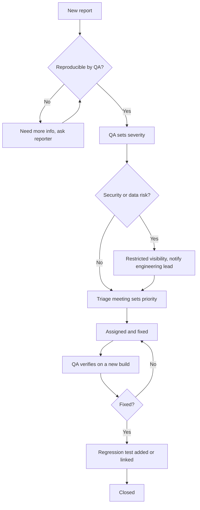

# Bug Reporting and Severity

How to report a bug, how severity and priority are assigned, and how bugs move from report to closure. Applies to QA testers, developers, designers, artists and external beta testers (who use the simplified form in §7).

> [!info] PROPOSED
> This process is a **PROPOSED** studio standard. The tracker tool is not specified; field names below are tool-agnostic.

## 1. Severity versus priority

- **Severity** describes the *impact* of the bug on players, data, compliance or the build. QA sets it, using the table below. It does not change because a fix is hard.
- **Priority** describes the *order of fixing*. Production sets it in triage, using severity, frequency, milestone and risk.

## 2. Severity levels

| Severity | Name | Definition | Game-specific examples |
|---|---|---|---|
| **S1** | Critical | Data loss or corruption; item, Cash or animal duplication or destruction; a confirmed rule broken; odds disclosure wrong; a security exploit; compliance breach; crash or soft-lock affecting most players; no workaround | Egg duplicated by disconnecting during a merge; backpack egg stolen; fourth animal stolen in one raid; offline base raided; displayed odds differ from used odds; stale `oddsVersion` accepted; team changed away from base; profile reset to defaults after a DataStore error; QA hook shipped in production |
| **S2** | Major | A core feature does not work or works wrongly for many players, with an awkward workaround or none; serious performance failure on target devices | Ascension consumes the wrong duplicate; merge fee charged twice; boss reward not granted; mobile frame rate below 30 FPS in standard combat; kill credit not awarded at 10%; raid never ends at `T_raid` |
| **S3** | Minor | A feature works with a noticeable defect, a reasonable workaround exists, or the effect is limited to an uncommon situation | Companion occasionally stuck for a few seconds before recovering; cooldown UI off by half a second; wrong rarity colour on one egg icon; sort order wrong in the animal inventory |
| **S4** | Trivial | Cosmetic issue with no gameplay effect | Typo; slightly misaligned icon; minor clipping of an ear through a hat during one emote |

**Escalation rules.**
- Any failure of a global invariant (INV-01 to INV-12 in [[QA Strategy]]) is **S1**, whatever its frequency.
- Anything that could mislead players about probabilities is **S1** and is also reviewed against [[Randomised Reward Compliance]].
- A bug reproducible only with an exploit client is still **S1** if it affects other players' items or the economy.
- A crash on any supported device class is at least **S2**.

## 3. Priority levels

| Priority | Meaning | Typical mapping |
|---|---|---|
| **P0** | Fix immediately; blocks the build, the milestone or the release | All S1; S2 in a release candidate |
| **P1** | Fix within the current milestone | Most S2; high-frequency S3 |
| **P2** | Fix when capacity allows, before launch if possible | Most S3 |
| **P3** | Fix if convenient; may be closed as "won't fix" | S4 and low-frequency S3 |

Priority wording deliberately matches the backlog priorities in [[Product Backlog]] (P0 Essential to P3 Low).

## 4. Required fields

| Field | Content | Required |
|---|---|---|
| Title | `[System] What goes wrong, when` (for example `[Raid] Fourth knocked-out animal can be stolen after attacker reconnects`) | Yes |
| Build | Build number, place (QA experience, staging, production) and server ID if known | Yes |
| Platform and device | PC, Mac, phone, tablet, console; model and graphics quality | Yes |
| Account state | Level, PS, relevant inventory, station level, PvP state; QA hooks used | Yes |
| Steps to reproduce | Numbered, minimal, from a known state | Yes |
| Expected result | Quote the test case (for example TC-RAID-033) or the design document | Yes |
| Actual result | What happened, including values | Yes |
| Reproduction rate | For example 5/5, 1/20; how many attempts | Yes |
| Severity | S1–S4 (QA) | Yes |
| Related IDs | Test case ID, decision ID (D-xxx), question ID (Q-xxx), backlog ID (BL-xxx) | When known |
| Evidence | Video, screenshots, MicroProfiler capture, server log excerpt, invariant report | Yes for S1/S2 |
| Security flag | "Restricted" if exploit steps are included | For exploits |

**Example report**

> **Title:** [Merge] Three Common eggs produce an Uncommon egg and are not removed after a client disconnect
> **Build:** 0.8.214, QA experience · **Device:** mid-range Android phone, auto quality
> **Account:** level 12, PS 118, station L1, 3 Common eggs in base storage, Cash 400
> **Steps:** 1) At base, open merge UI. 2) Select the three Common eggs. 3) Confirm. 4) Force-close the app within 0.5 s. 5) Rejoin.
> **Expected:** inputs removed, one Uncommon egg added, fee 100 charged once (TC-MRG-033).
> **Actual:** Uncommon egg added; the three Common eggs still present; Cash 300.
> **Rate:** 3/10 · **Severity:** S1 (INV-01 egg conservation) · **Evidence:** video, server log lines, invariant report.

## 5. Triage workflow

**Rules.**
1. S1 reports are triaged on the day they are filed; the rest at the regular triage meeting.
2. A bug is closed only after QA verifies it on a build that contains the fix.
3. Every fixed S1 and S2 bug gets a regression test case, either new or an existing case updated (cite its TC ID in the bug).
4. "Cannot reproduce" requires at least three documented attempts on the reporter's platform.
5. "Working as intended" requires a link to the design document or decision that defines the behaviour. If the behaviour depends on an **UNDECIDED** item, the bug is linked to the Q-ID and stays open until the owner decides.
6. Duplicate reports are linked, not deleted; the reproduction rate is merged.

## 6. Statuses

| Status | Meaning |
|---|---|
| New | Filed, not yet reviewed |
| Needs info | Cannot proceed without more detail |
| Confirmed | Reproduced by QA, severity set |
| Triaged | Priority and milestone set |
| In progress | Being fixed |
| Ready for test | Fix is in a build |
| Verified | QA confirmed the fix |
| Closed | Verified and regression coverage recorded |
| Won't fix | Accepted by production with a written reason |
| Blocked by decision | Waiting for an owner decision (Q-ID linked) |

## 7. External beta reports

Beta testers in [[M21 - Beta Testing]] use a short form: what happened, what they expected, device, rough time, and an optional video. QA converts useful reports into full reports. Players who report suspected odds problems are thanked and their report is checked against telemetry with the Wilson method in [[Statistical Testing of Probabilities]]; small personal samples are not treated as evidence on their own.

## 8. Metrics QA reports per milestone

| Metric | Use |
|---|---|
| Open bugs by severity and system | Gate decisions in [[QA Strategy]] |
| S1/S2 found after the feature's Definition of Done | Measures escaped defects ([[Definition of Done]]) |
| Reopen rate | Fix quality |
| Mean time from S1 report to verified fix | Process health (reported, not used as a target) |
| Bugs per test case executed per system | Where to add more testing |

## Related documents

- [[QA Strategy]]
- [[QA and Testing Index]]
- [[Test Plan Matrix]]
- [[Definition of Done]]
- [[Product Backlog]]
- [[Exploit Prevention]]
- [[Risk Register]]
- [[Template - Task]]
