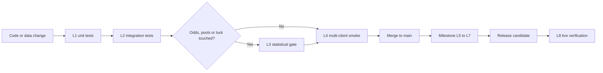

# QA Strategy

This document defines how *Fight Animals for Eggs* is tested: what we test, at which level, in which environment, with which tools, and what must be true before a milestone or release is accepted. The detailed cases live in the 14 test-case documents listed in [[QA and Testing Index]]; the coverage overview is the [[Test Plan Matrix]].

> [!info] PROPOSED
> Everything in this strategy is a **PROPOSED** QA process. It does not change any game rule. Where a game rule is **UNDECIDED**, the tests check the configurable parameter generically and never assume a value (see [[#6. Testing UNDECIDED parameters]]).

## 1. Quality goals

The game's riskiest promises are not visual. They are promises about fairness, ownership and data. The QA effort is weighted accordingly.

| # | Quality goal | Why it matters | Primary evidence |
|---:|---|---|---|
| G1 | **No item is ever created or destroyed outside a defined rule.** Eggs, animals and Cash are conserved across rolls, hatches, merges, ascensions and raids. | Duplication destroys the economy; loss destroys trust. | Invariant checks, transaction tests, [[Test Cases - Persistence]] |
| G2 | **Displayed odds are the odds used.** Odds are shown before commit and never change silently after purchase (D-017, D-041). | Compliance and player trust; see [[Randomised Reward Compliance]]. | [[Statistical Testing of Probabilities]], [[Test Cases - Egg Rolls and Hatching]] |
| G3 | **Every hatch is independent** (D-018). | Confirmed design promise. | Independence tests in [[Statistical Testing of Probabilities]] |
| G4 | **Raid theft rules hold under every timing**, including disconnects (D-021, D-024). | Theft is the most emotionally charged mechanic. | [[Test Cases - Raiding]] |
| G5 | **The server is authoritative.** No client can choose outcomes, values or targets it is not allowed to choose. | Roblox clients are fully modifiable. | [[Test Cases - Exploit Prevention]] |
| G6 | **Mid-range mobile holds 30 FPS minimum**, mid-range PC 60 FPS ([[Canonical Proposed Values]] §15). | Most of the audience plays on phones. | [[Test Cases - Mobile Performance]] |
| G7 | **Combat feels responsive and readable** for the player and three animals together. | Core loop quality (D-005). | [[Test Cases - Combat]], playtests |

## 2. Global invariants

Every automated suite and every manual session ends with an invariant check. An invariant failure is always severity **S1** ([[Bug Reporting and Severity]]). Test cases cite these IDs in their expected results.

| ID | Invariant | Source |
|---|---|---|
| INV-01 | Egg conservation: `eggs_after = eggs_before + rolled + merge_outputs + stolen_in − hatched − merge_inputs − stolen_out`, per player, per rarity. | D-015, D-020, D-024 |
| INV-02 | Animal conservation: `animals_after = animals_before + hatched + stolen_in − ascension_consumed − stolen_out`. | D-018, D-019, D-024 |
| INV-03 | Cash ledger: every Cash change has exactly one ledger reason (reward, roll, fee, upgrade, purchase) and the sum of ledger entries equals the balance change. Cash is a non-negative integer. | D-014 |
| INV-04 | The equipped team holds exactly **3** distinct, owned animal instances (see Q-1002 for players who own fewer than three). | D-006 |
| INV-05 | The equipped team never changes while the server considers the player outside their own base. | D-010 |
| INV-06 | No storage container ever exceeds its capacity (backpack 10, base 50 at start, plus purchased expansions). | D-021 |
| INV-07 | A backpack egg is never transferred to another player. | D-021 |
| INV-08 | At most **3** animals transfer to the attacker per raid, and only animals that were knocked out while defending. | D-024 |
| INV-09 | No raid can start against, or continue to steal from, a player who is offline. | D-024 |
| INV-10 | The odds used to resolve a roll or hatch are byte-identical to the odds the server issued with the accepted `oddsVersion`. | D-017, D-041 |
| INV-11 | No outcome (rarity, animal, damage, theft) is computed from client-supplied values other than the player's validated intent. | Security architecture |
| INV-12 | One player profile has at most one writable session at any time. | [[Data Consistency and Transactions]] |

> [!tip] Test hook
> The server build used for QA exposes a read-only `InvariantReport` (PROPOSED name) that computes INV-01 to INV-12 for every connected player. Automated suites call it after every step; manual testers run it from the QA panel at the end of each session.

## 3. Test levels

| Level | What is tested | Who | Tooling (PROPOSED) | Runs |
|---|---|---|---|---|
| L1 Unit | Pure modules: damage formula, luck formula, weighted selection, cost curves, validation functions, state machines | Engineers, QA automation | A Luau unit-test framework (for example TestEZ or an equivalent, choice **PROPOSED**) run in Studio or an offline Luau runtime | Every change |
| L2 Integration | One service with stubbed dependencies: `EggService` with a fake DataStore and an injected RNG, `RaidService` with a fake clock | Engineers, QA automation | Same framework, service test doubles | Every change to the service |
| L3 Simulation and statistics | Millions of rolls and hatches through the real selection code with a seeded RNG | QA automation | Offline harness; see [[Statistical Testing of Probabilities]] | Every change to odds, pools, luck or selection code; every release |
| L4 Multi-client functional | Real server and several clients in Studio (Test tab, local server with multiple players) | QA testers | Studio local server, QA panel, invariant report | Daily during active milestones |
| L5 Playtest sessions | Full sessions in a private test experience with 8–16 testers | QA lead, designers | Test experience with separate DataStores | Per milestone |
| L6 Soak and load | 60-minute sessions, full servers, scripted bots where possible | QA automation | Test experience, telemetry | Before M20, M21, M22 |
| L7 Device lab | Mobile and low-end PC captures | QA testers | Developer Console, MicroProfiler | Per milestone from M18 |
| L8 Live verification | Telemetry checks on production: observed rarity rates, raid counts, save failures | QA and analytics | [[Service - AnalyticsAndLoggingService]] | Continuously after launch |

## 4. Environments

| Environment | Purpose | Data | Rules |
|---|---|---|---|
| Local Studio | Development and L1–L4 | Local mock data or Studio access to the test experience's DataStores | API access to production is never enabled in Studio |
| QA test experience | L4–L7, playtests | Its own DataStores, entirely separate from production | QA hooks enabled behind a server-side allowlist of tester user IDs |
| Staging place | Release candidates | Separate DataStores; production configuration values | QA hooks disabled; identical to production build |
| Production | Live game | Live data | No QA hooks. Monitoring only. |

> [!danger] QA hooks must never ship
> Debug remotes (grant Cash, set Progression Score, force knock-out, set raid time remaining, inject DataStore errors) exist only in the QA build. The release checklist includes [[Test Cases - Exploit Prevention]] case TC-EXP-040, which verifies that no QA remote exists in the staging and production builds. Shipping one is a severity S1 security bug.

## 5. Design for testability (engineering requirements)

These requirements are inputs to [[Service Architecture]] and [[Luau Coding Standards]]. QA treats a missing hook as a blocking defect for the feature's Definition of Done ([[Definition of Done]]).

1. **Injectable randomness.** Every random draw goes through one RNG interface. In tests it can be seeded (`Random.new(seed)`) or replaced by a stub that returns scripted values. Production uses an unseeded server-side `Random.new()`.
2. **Injectable clock.** Cooldowns, combat tags, respawn timers, raid timers and shields read time from one clock source that tests can advance.
3. **Pure formula modules.** Damage, luck, cost curves and Progression Score are pure functions with no side effects, so their exact expected values can be asserted ([[Implementation - Dynamic Luck Calculation]], [[Implementation - Combat Damage Pipeline]]).
4. **Configuration modules.** Every tunable value, including every **UNDECIDED** parameter, is read from [[Configuration Modules]], and QA can override it in the QA build.
5. **Transaction results.** Every state-changing request returns a structured result (`ok`, `reason` code, new state version) so tests can assert the exact rejection reason.
6. **DataStore test double.** A fake DataStore that can inject errors, latency and budget exhaustion on demand.
7. **Telemetry events.** Every roll, hatch, merge, ascension, theft and save emits an event with the inputs needed to audit it ([[Logging and Error Handling]]).

## 6. Testing UNDECIDED parameters

Several confirmed systems depend on values the owner has not decided. QA must still test them, without inventing a number.

| Parameter | Status | How it is tested |
|---|---|---|
| Raid duration | **UNDECIDED** ([[Open Questions#Q-012]]) | As symbol `T_raid`. Tests set fixture values in the QA build and assert behaviour at `T_raid − ε`, `T_raid` and `T_raid + ε`. |
| Egg theft limit per raid | **UNDECIDED** ([[Open Questions#Q-013]]) | As symbol `L_egg`. Tests assert that exactly `L_egg` thefts succeed and theft `L_egg + 1` is rejected. |
| Defeat penalties per battle type | **UNDECIDED** ([[Open Questions#Q-014]]) | As a configuration row per battle type. Tests assert that the configured penalty is applied exactly once and that a "none" row applies nothing. |
| Storage expansion currency and price | **UNDECIDED** ([[Open Questions#Q-009]], [[Open Questions#Q-010]]) | As `C_exp` (currency) and `P_exp(step)` (price). Tests assert exact single deduction in the configured currency. |
| PvP activation method | **UNDECIDED** ([[Open Questions#Q-011]]) | Tests assert the server-side PvP state, whatever sets it. |
| Boss rewards | **UNDECIDED** ([[Open Questions#Q-015]]) | Tests assert "configured reward granted exactly once per eligible player per spawn". |
| What a stolen animal keeps | **UNDECIDED** ([[Open Questions#Q-025]]) | Each option is a configuration branch; both branches are tested so either decision is covered. |
| Shield acquisition | **UNDECIDED** ([[Open Questions#Q-030]]) | Tests assert that an active shield blocks raid start, regardless of how it was obtained. |
| Raid defenders | **UNDECIDED** ([[Open Questions#Q-033]], [[Open Questions#Q-035]]) | Tests use the set of animals the server marks as `Defending`. |

> [!warning] Fixture values are not proposals
> When a test sets `T_raid` or `L_egg` in the QA build, the value is a test fixture chosen only to make the test fast. Test documents must never print such a value as if it were a game value. Write it symbolically (`T_raid`, `L_egg`) in expected results.

## 7. Risk-based prioritisation

Test priority follows the bug's potential damage, not the feature's size.

| Test priority | Meaning | Gate rule |
|---|---|---|
| P0 | Protects a confirmed rule, an invariant, player data, compliance or security | 100% must pass for the milestone that owns the feature, and in every release regression |
| P1 | Core functional behaviour and high-traffic edge cases | ≥ 95% pass; every failure has a triaged bug with an agreed fix milestone |
| P2 | Secondary behaviour, UI polish, uncommon edges | Run at milestone; failures triaged |
| P3 | Cosmetic and nice-to-have | Run opportunistically |

Highest-risk areas (ordered): item duplication via concurrency or disconnect; odds disclosure mismatch; profile data loss; raid theft rule bypass; team-lock bypass; mobile frame rate in bosses and multi-hatch; Cash inflation via kill credit. These map to the [[Risk Register]].

## 8. Entry and exit criteria

| Phase | Milestones | Entry | Exit |
|---|---|---|---|
| Prototype | [[M02 - Core Project Setup]] to [[M07 - Animal Collection]] | Feature builds; L1 tests exist for every formula | All P0 L1/L2 tests pass; invariant report has no failures in a 30-minute L4 session |
| Feature complete per system | [[M08 - Egg Rolling]] to [[M17 - Boss Encounters]] | Feature meets its [[Definition of Done]] | All P0 cases in the system's test-case document pass; P1 ≥ 95%; statistical gates pass for M08, M09, M11 |
| Integration | [[M18 - UI and UX]], [[M19 - Multiplayer Testing]] | All systems feature complete | Full regression passes; 16-player sessions run 60 minutes with zero invariant failures |
| Optimisation | [[M20 - Optimisation]] | Integration exit | All P0 and P1 mobile performance cases pass on the reference device tiers |
| Beta | [[M21 - Beta Testing]] | Optimisation exit; zero open S1/S2 | External testers; telemetry-based rate checks match disclosed odds |
| Launch | [[M22 - Launch]] | Beta exit; every UNDECIDED item that "blocks beta" is decided or explicitly waived by the owner | Zero open S1/S2; release regression 100% P0; compliance checklist complete |
| Live | [[M23 - Live Updates]] | Launch | Every update passes the regression subset for touched systems plus the statistical gate if odds changed ([[Balance Update Process]]) |

## 9. Regression suites

| Suite | Content | Duration target (PROPOSED) | When |
|---|---|---|---|
| Smoke | Join, load profile, fight one wild animal, roll one egg, hatch one egg, equip team at base, leave base, rejoin, invariant report | ≤ 15 minutes manual, or automated | Every build |
| Core regression | All P0 cases | One tester-day | Every milestone build and release candidate |
| Full regression | All P0–P2 cases | Several tester-days | Milestone exit and release |
| Statistical gate | The L3 suite in [[Statistical Testing of Probabilities]] | Automated | Any odds, pool, luck or selection change; every release |
| Raid timing suite | Raid disconnect and concurrency cases | Half a tester-day with two to three accounts | Any change to raids, persistence or networking |

## 10. Roles

| Role | Responsibility |
|---|---|
| Quality Assurance Director | Owns this strategy, the gates and the [[Test Plan Matrix]]; signs off milestone exits |
| QA testers | Execute manual cases, write bug reports ([[Bug Reporting and Severity]]), run device captures |
| QA automation engineer | Builds L1–L3 and L6 automation, maintains the invariant report and the statistical harness |
| Feature engineers | Write L1/L2 tests with the feature; supply test hooks |
| Designers | Review expected results against design intent; own balance acceptance |
| Production Manager | Ensures every backlog item references its test cases ([[Product Backlog]]) |
| Project owner | Decides UNDECIDED items; waives a gate only in writing in the [[Decision Register]] |

## 11. Live verification after launch

After launch, QA compares observed outcomes with disclosed odds using the telemetry stream. Observed rates per rarity are checked with the Wilson-interval method in [[Statistical Testing of Probabilities]], bucketed by `oddsVersion`. A sustained deviation outside the 99.9% interval opens an S1 compliance bug and triggers the [[Balance Update Process]] review. Raid outcome telemetry is checked weekly against INV-07 to INV-09.

## Related documents

- [[QA and Testing Index]]
- [[Test Plan Matrix]]
- [[Statistical Testing of Probabilities]]
- [[Bug Reporting and Severity]]
- [[Definition of Done]]
- [[Product Backlog]]
- [[Exploit Prevention]]
- [[Threat Model]]
- [[Data Consistency and Transactions]]
- [[Randomised Reward Compliance]]
- [[Performance Guidelines]]
- [[Template - Test Case]]
