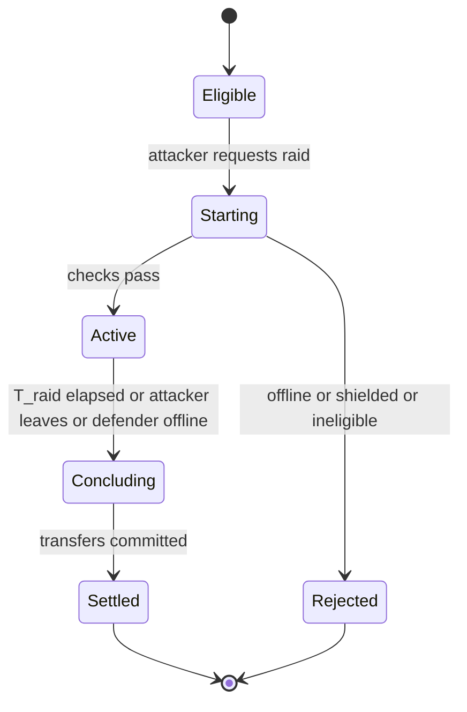

# Test Cases - Raiding

Test cases for base raids: eligibility and offline protection, raid lifecycle and duration, egg theft, animal theft and the three-animal limit, disconnection handling, concurrency and defences. System documents: [[Base Raiding System]], [[Raid Lifecycle and States]], [[Raid Eligibility and Offline Protection]], [[Egg Theft Rules]], [[Animal Theft Rules]], [[Raid Disconnection Handling]], [[Raid Anti-Exploit Validation]], [[Raid Rewards and Defender Compensation]], [[Implementation - Raid Session Controller]], [[Service - RaidService]].

> [!success] CONFIRMED rules under test
> Raids are optional. Eggs stored in the base can be stolen; backpack eggs can never be stolen (D-021). A defending animal can be stolen only after it has been knocked out; undefeated defenders cannot be stolen; at most **three** animals are stolen per successful raid; offline bases cannot be raided; bases are protected by shields and physical defences (D-024).

> [!warning] UNDECIDED parameters (tested generically, no values assumed)
> - Raid duration `T_raid` ([[Open Questions#Q-012]]).
> - Egg theft limit per raid `L_egg` ([[Open Questions#Q-013]]).
> - Raid defeat penalties ([[Open Questions#Q-014]]).
> - What a stolen animal keeps and what happens to the victim's team ([[Open Questions#Q-025]]).
> - Matchmaking bands ([[Open Questions#Q-029]]), shield acquisition ([[Open Questions#Q-030]]), which animals defend ([[Open Questions#Q-033]], [[Open Questions#Q-035]]).
> - Stolen-item destination when the attacker has no capacity (Q-1007), concurrent raids on one base (Q-1008), defender disconnect handling (Q-1009).
>
> In the QA build these are set as fixtures. Fixture values are never game values and are not written in this document.

**Fixtures.** `QA_StartRaidAgainst(player)`, `QA_SetConfig("RaidDuration", T_raid)`, `QA_SetConfig("EggTheftLimit", L_egg)`, `QA_ForceKnockOut(animalId)`, `QA_AdvanceClock(s)`, `QA_DropClient(player)`, `QA_KillServer()`, `QA_KillServerBetweenWrites()`, `QA_InjectDataStoreError(op)`. Tests need at least two accounts (attacker A, defender D) and some need a third (B).

## 1. Eligibility and offline protection

| ID | Title | Preconditions | Steps | Expected result | Priority | Type | Decision |
|---|---|---|---|---|---|---|---|
| TC-RAID-001 | Raid is optional for the attacker | A has not chosen to raid | 1) Play normally for 30 minutes near D's base. | No raid starts without A's explicit action. | P0 | functional | D-024 |
| TC-RAID-002 | Raid eligibility rules | Eligibility per [[Raid Eligibility and Offline Protection]] (opt-in model Q-011, bands Q-029) | 1) A requests a raid on each of: an eligible player, an ineligible player. | Eligible: raid starts. Ineligible: rejected with a reason code; no state change for either player. | P0 | functional | D-024 |
| TC-RAID-003 | Raiding an offline player | D has left the game | 1) A tries to find or target D's base. 2) A sends a crafted raid request with D's user ID. | D's base is not present in the world and not listed as a target. The request is rejected `target_offline`. D's data is not loaded or modified. | P0 | edge | D-024 |
| TC-RAID-004 | Defender leaves between selection and start | A selected D; D leaves before the raid starts | 1) A confirms. | Rejected `target_offline`. | P0 | edge | D-024 |
| TC-RAID-005 | Shielded base | D's shield active | 1) A requests a raid. | Rejected `shielded`. | P0 | negative | D-024 |
| TC-RAID-006 | Raiding oneself | — | 1) A requests a raid on A. | Rejected `invalid_target`. | P1 | negative | D-024 |
| TC-RAID-007 | Concurrent raids on one base | A is raiding D; B requests a raid on D | 1) B confirms. | Behaviour per the Q-1008 outcome. **PROPOSED** working assumption: rejected `already_under_raid`. In any case INV-08 holds per raid and no item is taken twice. | P1 | edge | D-024 |
| TC-RAID-008 | One attacker, two raids | A is in an active raid | 1) A requests a second raid. | Rejected `already_raiding`. | P1 | negative | D-024 |

## 2. Duration and lifecycle

| ID | Title | Preconditions | Steps | Expected result | Priority | Type | Decision |
|---|---|---|---|---|---|---|---|
| TC-RAID-010 | Raid ends at the configured duration | `T_raid` configured | 1) Start raid. 2) Advance to `T_raid − ε`, `T_raid`, `T_raid + ε`. | Active at `T_raid − ε`; enters Concluding at `T_raid`; any theft request after `T_raid` is rejected `raid_over`. | P0 | functional | Q-012 |
| TC-RAID-011 | Duration is read from configuration | Two different fixture values | 1) Run TC-RAID-010 with each. | Raid length follows the configured value each time; no hard-coded duration exists in `RaidService`. | P0 | functional | Q-012 |
| TC-RAID-012 | Invalid duration configuration | `T_raid` missing, zero, negative or NaN | 1) Boot server. 2) Attempt a raid. | **PROPOSED**: configuration validation fails at boot with a logged error; raids are disabled (`raids_unavailable`) instead of running with an undefined length. | P1 | negative | Q-012 |
| TC-RAID-013 | Raid timer UI | Raid active | 1) Compare attacker and defender timers with the server. | Both show the server's remaining time within one second ([[UI - Raid Interface]]). | P2 | functional | Q-012 |
| TC-RAID-014 | Defender is alerted | D online elsewhere in the world | 1) A starts a raid. | D receives an alert with sound ([[Sound - Base and Raid Alerts]], [[UI - Notifications]]) and a way to return to the base. | P1 | functional | D-024 |
| TC-RAID-015 | Raid summary | Raid settled | 1) Read both summaries. | Both list exactly the items transferred; counts match the ledger and INV-01, INV-02. | P1 | functional | D-024 |
| TC-RAID-016 | Post-raid protection | Raid settled | 1) Another attacker tries immediately. | Follows the shield rule configured for Q-030; if a post-raid shield is configured, rejected `shielded`. | P1 | functional | Q-030 |

## 3. Egg theft

| ID | Title | Preconditions | Steps | Expected result | Priority | Type | Decision |
|---|---|---|---|---|---|---|---|
| TC-RAID-020 | Steal a base-stored egg | Raid active; D has eggs in base storage | 1) A interacts with an egg in D's vault. | Egg moves from D's base storage to A's inventory (destination per [[Egg Theft Rules]]); rarity unchanged; both ledgers record the transfer. | P0 | functional | D-024 |
| TC-RAID-021 | Stealing backpack eggs | D has eggs in the backpack | 1) A inspects D's base and D's character for steal prompts. 2) A sends a crafted theft request with a backpack egg ID. | No steal prompt exists for backpack eggs and their IDs are not replicated to A. The crafted request is rejected `not_stealable`; the egg stays in D's backpack; security log entry. | P0 | edge | D-021 |
| TC-RAID-022 | Egg theft limit | `L_egg` configured; D has more than `L_egg` base eggs | 1) A steals `L_egg` eggs. 2) A attempts one more. | First `L_egg` succeed; attempt `L_egg + 1` is rejected `egg_limit_reached`; UI shows the limit as reached. | P0 | functional | Q-013 |
| TC-RAID-023 | Theft limit counter survives reconnect | A has stolen `L_egg − 1` eggs | 1) A's client reconnects within the raid (if the raid survives per [[Raid Disconnection Handling]]). 2) A steals two more. | Only one more succeeds; the counter is server-side per raid. | P0 | edge | Q-013 |
| TC-RAID-024 | Attacker has no free egg capacity | A's storage full | 1) A attempts theft. | Behaviour per the Q-1007 outcome. **PROPOSED**: rejected `no_capacity` and the egg stays with D. An egg is never destroyed (INV-01, INV-06). | P0 | edge | D-021 |
| TC-RAID-025 | Steal an egg the defender is using | D hatching or merging egg E as A steals it | 1) Both commit in the same frame. | Exactly one commits (see TC-EGG-068, TC-MRG-028, TC-MP-020). | P0 | edge | D-024 |
| TC-RAID-026 | Stolen egg is an ordinary egg | A stole a Rare egg | 1) A hatches it. | Hatches from the Rare pool at A's current odds, displayed before commit (D-017). | P1 | functional | D-017 |
| TC-RAID-027 | Steal after the raid ends | Raid in Concluding or Settled | 1) A sends a theft request. | Rejected `raid_over`. | P0 | negative | Q-012 |

## 4. Animal theft and the three-animal limit

| ID | Title | Preconditions | Steps | Expected result | Priority | Type | Decision |
|---|---|---|---|---|---|---|---|
| TC-RAID-030 | Steal a knocked-out defender | Defender X knocked out (server flag) | 1) A interacts with X. | X transfers to A per the transfer rule; D no longer owns X. Counter 1/3. | P0 | functional | D-024 |
| TC-RAID-031 | Stealing a defending animal that was not defeated | Defender Y at full or partial HP, not knocked out | 1) A's client shows no steal prompt on Y. 2) A sends a crafted theft request for Y. | Rejected `not_knocked_out`; Y stays with D; security log entry. | P0 | edge | D-024 |
| TC-RAID-032 | Defender recovers before theft | X knocked out, then recovers | 1) A tries to steal X after recovery. | Rejected `not_knocked_out` (eligibility evaluated at commit time). | P0 | edge | D-024 |
| TC-RAID-033 | Stealing four animals in one raid | Four defenders knocked out | 1) Steal three. 2) Attempt the fourth. | The first three succeed (counter 3/3). The fourth is rejected `animal_limit_reached`; it stays with D; UI shows the limit as reached. | P0 | edge | D-024 |
| TC-RAID-034 | Limit holds across reconnect and retries | A has stolen 3 | 1) A reconnects. 2) Retries the fourth repeatedly. | All attempts rejected; final transfers to A ≤ 3 (INV-08). | P0 | security | D-024 |
| TC-RAID-035 | Non-defending animals cannot be stolen | D owns animals that are not marked `Defending` | 1) A sends a crafted request for one. | Rejected `not_stealable` (**PROPOSED** reading of D-024: only knocked-out defenders are eligible). | P0 | security | D-024 |
| TC-RAID-036 | Stolen equipped animal | X is in D's equipped team and was knocked out while defending (if Q-033/Q-035 allow equipped animals to defend) | 1) A steals X. 2) D inspects the team. | X belongs to A. D's team never references X (INV-04 for D). Slot handling follows the Q-025 outcome; D can refill the team at base. A's team is unchanged until A changes it at A's base (D-010). | P0 | edge | D-024, Q-025 |
| TC-RAID-037 | What a stolen animal keeps: branch "keeps ascension and variant" | Q-025 configuration branch 1 | 1) Steal an A3 Golden animal. | A receives it at A3 with the variant. | P1 | functional | Q-025 |
| TC-RAID-038 | What a stolen animal keeps: branch "resets" | Q-025 configuration branch 2 | 1) Steal an A3 Golden animal. | A receives it with the properties defined by that branch; D's consumed duplicates are not refunded unless configured. | P1 | functional | Q-025 |
| TC-RAID-039 | Attacker's animal storage full | A at `N_animals` | 1) A attempts to steal a knocked-out defender. | **PROPOSED**: rejected `animal_storage_full`; the animal stays with D (Q-1007). It never disappears. | P0 | edge | Q-022 |

## 5. Disconnection and failure

| ID | Title | Preconditions | Steps | Expected result | Priority | Type | Decision |
|---|---|---|---|---|---|---|---|
| TC-RAID-040 | Attacker disconnects during a raid | A has committed some thefts | 1) `QA_DropClient(A)`. | Raid moves to Concluding. Committed transfers remain with A; any in-progress (uncommitted) theft is cancelled and the item stays with D. D is notified. No duplication: each item exists exactly once. | P0 | edge | D-024 |
| TC-RAID-041 | Defender disconnects during a raid | Raid active | 1) `QA_DropClient(D)`. | No theft is accepted after the server detects D's disconnect (offline protection, INV-09). The raid ends per [[Raid Disconnection Handling]] (immediate end versus grace window is **UNDECIDED**, Q-1009). Transfers committed before the disconnect stand; D's profile is saved once with them. | P0 | edge | D-024 |
| TC-RAID-042 | Both disconnect | Raid active | 1) Drop both. | Raid ends; both profiles saved consistently; each item in exactly one profile. | P0 | edge | D-024 |
| TC-RAID-043 | Server shuts down mid-raid | Raid active | 1) Trigger shutdown (`game:BindToClose` path). | Raid settles before shutdown or is rolled back to the last committed transfer; both profiles saved; no item duplicated or lost. | P0 | edge | D-024 |
| TC-RAID-044 | Crash between the two profile writes | `QA_KillServerBetweenWrites()` after A's write, before D's | 1) Steal an egg. 2) Both rejoin. | Recovery via the transfer log ([[Data Consistency and Transactions]]): the egg is in exactly one profile after both load. | P0 | edge | D-024 |
| TC-RAID-045 | Rejoining another server mid-raid | A disconnects, rejoins a different server immediately | 1) Observe A's profile and the old raid. | The old raid has ended; A's profile loads only after the old session's lock is released; A's inventory equals the committed state. A cannot continue the raid from the new server. | P0 | edge | D-024 |
| TC-RAID-046 | Defender rejoins another server mid-raid | D drops and rejoins a different server | 1) Observe. | Old raid ended; D's base loads on the new server with the committed state; A cannot follow and continue stealing. | P0 | edge | D-024 |
| TC-RAID-047 | DataStore failure during settlement | `QA_InjectDataStoreError("UpdateAsync")` | 1) Settle a raid. | Retries per [[Save, Load and Recovery]]; transfer log kept until both writes succeed; no item lost; alert logged. | P0 | edge | D-024 |

## 6. Defences and penalties

| ID | Title | Preconditions | Steps | Expected result | Priority | Type | Decision |
|---|---|---|---|---|---|---|---|
| TC-RAID-050 | Physical defences hurt raiders | Defence Station built | 1) A crosses traps and turret range. | A and A's animals take the configured damage; D and visitors do not. | P1 | functional | D-024 |
| TC-RAID-051 | Defenders fight back | Defenders marked `Defending` | 1) A enters. | Defenders engage A (TC-AI-050). | P0 | functional | Q-033 |
| TC-RAID-052 | Attacker defeated during a raid | A's defeat condition met | 1) Observe. | Raid concludes per [[Raid Lifecycle and States]]; the configured raid-attack penalty applies exactly once (Q-014). | P1 | functional | Q-014 |
| TC-RAID-053 | Defender defeated during a raid | D present and defeated | 1) Observe. | The configured raid-defence penalty applies exactly once (Q-014); D's backpack eggs remain unstealable. | P1 | functional | Q-014 |
| TC-RAID-054 | Defender compensation | Raid settled with losses | 1) Read D's summary. | Compensation (if configured in [[Raid Rewards and Defender Compensation]]) granted once. | P2 | functional | D-024 |

## 7. Movement and validation

| ID | Title | Preconditions | Steps | Expected result | Priority | Type | Decision |
|---|---|---|---|---|---|---|---|
| TC-RAID-060 | Theft requires proximity | A far from the egg | 1) Send a theft request from 100 studs away. | Rejected `out_of_range`; interaction range enforced on the server ([[Raid Anti-Exploit Validation]]). | P0 | security | D-024 |
| TC-RAID-061 | Theft through a shield | Shield active, raid not started | 1) Send theft request. | Rejected `no_active_raid`. | P0 | security | D-024 |
| TC-RAID-062 | Theft request spam | Raid active | 1) Send 100 theft requests per second for one egg. | One success at most; rate limiter throttles the rest. | P0 | security | D-024 |

## Related documents

- [[Test Cases - PvP]]
- [[Test Cases - Bases and Upgrades]]
- [[Test Cases - Multiplayer]]
- [[Test Cases - Persistence]]
- [[Test Cases - Exploit Prevention]]
- [[Base Raiding System]]
- [[Raid Lifecycle and States]]
- [[Raid Eligibility and Offline Protection]]
- [[Egg Theft Rules]]
- [[Animal Theft Rules]]
- [[Raid Disconnection Handling]]
- [[Raid Anti-Exploit Validation]]
- [[Implementation - Raid Session Controller]]
- [[Service - RaidService]]
- [[UI - Raid Interface]]
