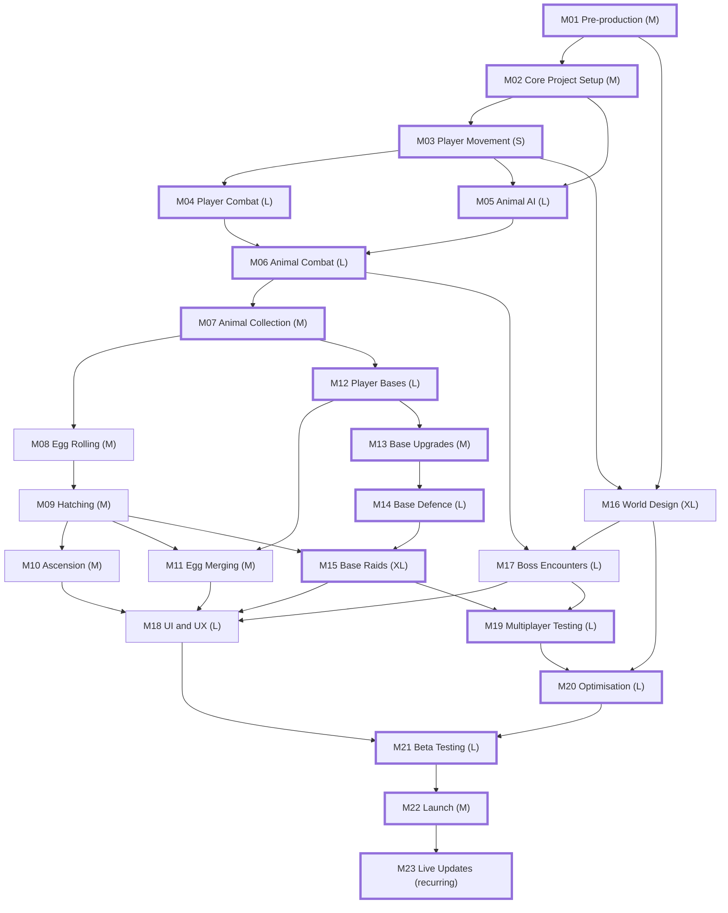

# Development Roadmap

The staged production plan for *Fight Animals for Eggs*, from pre-production to live operations. It defines 23 milestones, the order they depend on each other, the disciplines that work in parallel, and the critical path.

> [!info] PROPOSED — the whole plan
> Every milestone, gate and size in this document is a **PROPOSED** production plan. Nothing here is an owner decision. Game rules referenced here keep the status they have in the [[Decision Register]].

> [!warning] No dates
> This roadmap deliberately contains **no deadlines or calendar dates**. Team size and staffing are **UNDECIDED** (Q-1101), so any date would be invented. Milestones are sized by **relative complexity** only. Dates can be derived later from measured team throughput.

## Planning principles

1. **Vertical slices before breadth.** Prove one region, a handful of animals and the full loop before building 60 animals and eight regions.
2. **Server authority from the first line.** Security and persistence are built into each feature milestone, not added at the end ([[Server-Client Responsibilities]]).
3. **Configurable undecided values.** Every **UNDECIDED** value (raid duration, egg theft limit, defeat penalties, expansion pricing) ships as a config entry in [[Configuration Modules]] so that an owner decision never needs a code change.
4. **Feature UI ships with the feature.** Each feature milestone delivers its functional screen. [[M18 - UI and UX]] is the consistency, onboarding and accessibility pass, not the first time UI is built.
5. **Testing is part of done.** Each milestone lists the test case documents it must pass. See [[Definition of Done]] and [[Test Plan Matrix]].
6. **Compliance is a gate, not a task.** Odds disclosure (D-017) and monetisation rules (D-027) are checked at every gate that touches eggs or the shop.

## Complexity scale

| Size | Meaning (relative) | Planning weight (PROPOSED) | Typical shape |
|---|---|---:|---|
| **S** | One system, few unknowns, one or two disciplines | 1 | Movement tuning, a single screen |
| **M** | One system with persistence or UI, moderate unknowns | 2 | Ascension, egg rolling |
| **L** | Several interacting systems, or heavy content production | 3 | Combat, AI, bases |
| **XL** | Cross-cutting, multiplayer-sensitive, or the largest content load | 5 | Raids, world content |

The planning weights are a **PROPOSED** local convention used only to compare paths in the dependency graph. They are not time estimates.

## Stages and milestones

| Stage | Milestones | Goal | Exit gate |
|---|---|---|---|
| 0. Pre-production | [[M01 - Pre-production]] | Scope, decisions and plan agreed | G0 Concept locked |
| 1. Foundations | [[M02 - Core Project Setup]], [[M03 - Player Movement]] | A running, persistent, secure skeleton | G1 Technical foundation |
| 2. Combat slice | [[M04 - Player Combat]], [[M05 - Animal AI]], [[M06 - Animal Combat]] | The player and three animals fight wild animals in one greybox region | G2 Combat slice |
| 3. Collection loop | [[M07 - Animal Collection]], [[M08 - Egg Rolling]], [[M09 - Hatching]], [[M10 - Ascension]] | Fight → cash → roll → hatch → equip → ascend, end to end | G3 Core loop slice |
| 4. Bases | [[M11 - Egg Merging]], [[M12 - Player Bases]], [[M13 - Base Upgrades]], [[M14 - Base Defence]] | Personal modular bases with upgrades, merging and defences | G4 Base alpha |
| 5. PvP and raids | [[M15 - Base Raids]] | Optional PvP and raids with the **CONFIRMED** theft rules | G5 Feature complete (with M16, M17) |
| 6. World and bosses (parallel from stage 2) | [[M16 - World Design]], [[M17 - Boss Encounters]] | All launch regions, mini-bosses and world bosses | G5 Feature complete |
| 7. Hardening | [[M18 - UI and UX]], [[M19 - Multiplayer Testing]], [[M20 - Optimisation]] | Consistent UX, multiplayer robustness and performance targets | G6 Beta ready |
| 8. Beta and launch | [[M21 - Beta Testing]], [[M22 - Launch]] | External validation, tuning and public release | G7 Launch ready, G8 Launched |
| 9. Live | [[M23 - Live Updates]] | Sustainable live operations | Recurring release reviews |

## Milestone summary

| ID | Milestone | Stage | Size | Depends on | Lead tracks |
|---|---|---:|:---:|---|---|
| M01 | [[M01 - Pre-production]] | 0 | M | — | Design, Production |
| M02 | [[M02 - Core Project Setup]] | 1 | M | M01 | Engineering |
| M03 | [[M03 - Player Movement]] | 1 | S | M02 | Engineering, Animation |
| M04 | [[M04 - Player Combat]] | 2 | L | M03 | Engineering, Design, Animation |
| M05 | [[M05 - Animal AI]] | 2 | L | M02, M03 | Engineering |
| M06 | [[M06 - Animal Combat]] | 2 | L | M04, M05 | Engineering, Design, VFX |
| M07 | [[M07 - Animal Collection]] | 3 | M | M06 | Engineering, UI |
| M08 | [[M08 - Egg Rolling]] | 3 | M | M07 | Engineering, Economy, Compliance |
| M09 | [[M09 - Hatching]] | 3 | M | M08 | Engineering, Animation, Audio |
| M10 | [[M10 - Ascension]] | 3 | M | M09 | Engineering, Economy, VFX |
| M11 | [[M11 - Egg Merging]] | 4 | M | M09, M12 | Engineering, Art |
| M12 | [[M12 - Player Bases]] | 4 | L | M07 | Engineering, Art |
| M13 | [[M13 - Base Upgrades]] | 4 | M | M12 | Engineering, Economy, Art |
| M14 | [[M14 - Base Defence]] | 4 | L | M13 | Engineering, Design |
| M15 | [[M15 - Base Raids]] | 5 | XL | M14, M09 | Engineering, Design, Security |
| M16 | [[M16 - World Design]] | 6 | XL | M01, M03 | Art, Design, Audio |
| M17 | [[M17 - Boss Encounters]] | 6 | L | M06, M16 | Design, Engineering, Art |
| M18 | [[M18 - UI and UX]] | 7 | L | M10, M11, M15, M17 | UI, Art, Audio |
| M19 | [[M19 - Multiplayer Testing]] | 7 | L | M15, M17 | QA, Engineering |
| M20 | [[M20 - Optimisation]] | 7 | L | M16, M19 | Engineering, Technical Art |
| M21 | [[M21 - Beta Testing]] | 8 | L | M18, M20 | QA, Live Ops, Economy |
| M22 | [[M22 - Launch]] | 8 | M | M21 | Production, Live Ops |
| M23 | [[M23 - Live Updates]] | 9 | M (recurring) | M22 | Live Ops, all tracks |

## Dependency graph

Arrows read "must be complete (or at its acceptance criteria) before". Thick-bordered nodes are on the critical path.

## Critical path

Using the planning weights (S 1, M 2, L 3, XL 5), the earliest start and finish of each milestone, in **relative units** (not weeks), are:

| Milestone | Earliest start | Earliest finish | Slack | On critical path |
|---|---:|---:|---:|:---:|
| M01 | 0 | 2 | 0 | Yes |
| M02 | 2 | 4 | 0 | Yes |
| M03 | 4 | 5 | 0 | Yes |
| M04 | 5 | 8 | 0 | Yes |
| M05 | 5 | 8 | 0 | Yes (co-critical with M04) |
| M06 | 8 | 11 | 0 | Yes |
| M07 | 11 | 13 | 0 | Yes |
| M08 | 13 | 15 | 4 | No (near-critical) |
| M09 | 15 | 17 | 4 | No (near-critical) |
| M10 | 17 | 19 | 10 | No |
| M11 | 17 | 19 | 10 | No |
| M12 | 13 | 16 | 0 | Yes |
| M13 | 16 | 18 | 0 | Yes |
| M14 | 18 | 21 | 0 | Yes |
| M15 | 21 | 26 | 0 | Yes |
| M16 | 5 | 10 | 13 | No (throughput-critical, see below) |
| M17 | 11 | 14 | 12 | No |
| M18 | 26 | 29 | 3 | No (near-critical) |
| M19 | 26 | 29 | 0 | Yes |
| M20 | 29 | 32 | 0 | Yes |
| M21 | 32 | 35 | 0 | Yes |
| M22 | 35 | 37 | 0 | Yes |
| M23 | 37 | recurring | — | Yes |

**Critical path:** M01 → M02 → M03 → M04 / M05 → M06 → M07 → M12 → M13 → M14 → M15 → M19 → M20 → M21 → M22 → M23.

What this means in practice:

- **The base-and-raid chain sets the pace, not eggs.** Bases ([[M12 - Player Bases]]) must start as soon as collection and team equipping exist, because team changes only happen at the base (D-010) and raids need bases, upgrades and defences first.
- **[[M15 - Base Raids]] is the single largest risk on the path.** It is XL, multiplayer-sensitive and carries the highest security risks (R-023, R-024 in [[Risk Register]]). Raid prototyping with configurable duration and theft limits ([[Open Questions#Q-012]], [[Open Questions#Q-013]]) should begin as a spike during M14.
- **The egg chain is near-critical for compliance, not schedule.** M08 and M09 have only 4 units of slack before they delay M15, and they carry the odds-disclosure obligations. Do not borrow their slack for feature additions.
- **[[M16 - World Design]] has large schedule slack but is throughput-critical.** It is the largest content load (8 regions, 60 animals placed, 12 bosses). Its slack exists only if the art track starts at stage 2 and keeps a steady rate. Treat the art production rate as a tracked metric (R-027).

## Parallel tracks

Each stage has work for every discipline. Animation and VFX sit under Art; UI sits under Design and Art.

| Stage | Engineering | Design | Art (incl. animation, VFX) | Audio | QA |
|---|---|---|---|---|---|
| 0. Pre-production | Architecture spikes: data, remotes, AI scale ([[Architecture Overview]]) | Pillars, loop, scope, first balance pass ([[Canonical Proposed Values]]) | Style frames, rig standards, first low-poly test animal ([[Art Bible]]) | Sound pillars ([[Sound Bible]]) | [[QA Strategy]], [[Test Plan Matrix]] skeleton |
| 1. Foundations | Project hierarchy, services, DataService, remote validation, logging | Movement feel targets, control schemes | Player rig, locomotion set, greybox kit | Footsteps, UI click set | Persistence and exploit test harness |
| 2. Combat slice | Damage pipeline, AI state machine, spawning, targeting | Combat tuning, role definitions, first 6–10 animals | Body-plan rigs, attack and hit animations, combat VFX | Impact and vocalisation sets | [[Test Cases - Combat]], [[Test Cases - Animal AI]] |
| 3. Collection loop | Inventory, index, luck, roll and hatch transactions, ascension | Odds, pools, ascension curve, economy model | Egg models, hatch and ascension animations; roster production at steady rate | Egg and ascension stingers | Odds sampling, [[Test Cases - Egg Rolls and Hatching]] |
| 4. Bases | Base plots, modules, upgrades, merge transaction, guard AI | Module effects, costs, defence layouts | Module models per level, station upgrade visuals | Base ambience, upgrade sounds | [[Test Cases - Bases and Upgrades]], [[Test Cases - Egg Merging]] |
| 5. PvP and raids | Raid session controller, theft transactions, PvP opt-in | Raid rules within **CONFIRMED** limits, matchmaking options | Shield and raid interaction VFX | Raid alerts ([[Sound - Base and Raid Alerts]]) | [[Test Cases - Raiding]], [[Test Cases - PvP]] |
| 6. World and bosses | Region streaming, boss AI, world boss scheduling | Region layouts, unlock flow, boss encounter design | Region kits, remaining roster, bosses | Region ambience, boss themes ([[Music Direction]]) | [[Test Cases - Bosses]] |
| 7. Hardening | Load tests, profiling, memory and network optimisation | Onboarding, UX consistency | UI polish, LOD and texture budgets | Mix pass ([[Audio Mixing and Priority]]) | [[Test Cases - Multiplayer]], [[Test Cases - Mobile Performance]] |
| 8. Beta and launch | Telemetry, hotfix path, kill switches | Tuning from telemetry | Store assets, final polish | Final mix | Full regression, statistical re-verification |
| 9. Live | Content pipeline, config versioning | Content expansion, balance updates | New animals, variants, events | Event audio | Update regression ([[Content Update Pipeline]]) |

## Stage gates

A gate passes only when every listed criterion is met and the [[Risk Register]] has been re-scored.

| Gate | After | Pass criteria (PROPOSED) |
|---|---|---|
| G0 Concept locked | M01 | Owner has reviewed scope; every "Blocks prototype" question in [[Open Questions]] has a working assumption; launch cut line discussed (Q-1103). |
| G1 Technical foundation | M02, M03 | A player joins, moves, saves and reloads with no data errors; every remote goes through the validation layer; logging works. |
| G2 Combat slice | M04–M06 | Player plus three animals defeat wild animals in one greybox region; kill credit and rewards work for at least two players; internal playtest says combat is readable (R-002). |
| G3 Core loop slice | M07–M10 | A new account completes fight → cash → roll → hatch → equip → ascend; displayed odds equal server odds in automated parity checks; independent-outcome tests pass. |
| G4 Base alpha | M11–M14 | Bases, upgrades, merging and defences work and persist; team change works only at the base. |
| G5 Feature complete | M15–M17 | All launch features exist behind config; every **CONFIRMED** raid rule passes [[Test Cases - Raiding]]; all launch regions and bosses are playable (placeholder art allowed). |
| G6 Beta ready | M18–M20 | Every "Blocks beta" question resolved by the owner; performance targets met on reference devices; no known data-loss or duplication defect. |
| G7 Launch ready | M21 | Every "Blocks launch" question resolved; compliance review signed; release checklist in [[Versioning and Changelog Policy]] complete. |
| G8 Launched | M22 | Public release stable; hotfix lane proven; live ops cadence agreed (Q-1104). |

## Decisions needed per gate

Owner decisions are the main schedule risk (R-029). This table tells the owner which questions block which gate.

| Gate | Questions that must be resolved | Questions that need a working assumption only |
|---|---|---|
| G0 | — | [[Open Questions#Q-008]], [[Open Questions#Q-011]], [[Open Questions#Q-021]], [[Open Questions#Q-023]], [[Open Questions#Q-025]], [[Open Questions#Q-028]], [[Open Questions#Q-031]], [[Open Questions#Q-033]], [[Open Questions#Q-034]] |
| G2 | — | [[Open Questions#Q-014]] (configurable penalties) |
| G3 | — | [[Open Questions#Q-016]], [[Open Questions#Q-017]], [[Open Questions#Q-018]], [[Open Questions#Q-020]] |
| G5 | — | [[Open Questions#Q-012]], [[Open Questions#Q-013]] (configurable) |
| G6 (beta) | [[Open Questions#Q-001]], [[Open Questions#Q-002]], [[Open Questions#Q-004]], [[Open Questions#Q-006]], [[Open Questions#Q-007]], [[Open Questions#Q-009]], [[Open Questions#Q-012]], [[Open Questions#Q-013]], [[Open Questions#Q-014]], [[Open Questions#Q-015]], [[Open Questions#Q-020]], [[Open Questions#Q-022]], [[Open Questions#Q-024]], [[Open Questions#Q-027]], [[Open Questions#Q-029]], [[Open Questions#Q-030]], [[Open Questions#Q-035]]; beta format (Q-1102) | — |
| G7 (launch) | [[Open Questions#Q-003]], [[Open Questions#Q-005]], [[Open Questions#Q-010]], [[Open Questions#Q-016]], [[Open Questions#Q-017]], [[Open Questions#Q-018]], [[Open Questions#Q-019]], [[Open Questions#Q-026]], [[Open Questions#Q-032]]; content rating answers (Q-1116); odds sign-off authority (Q-1117) | — |
| G8 | Live update cadence (Q-1104) | Event rules (Q-1105, Q-1113, Q-1114) |

## Roadmap-level open questions

> [!warning] UNDECIDED
> - **UNDECIDED** (Q-1101): studio staffing and discipline ownership (how many people per track, and who owns each service). Needed to convert sizes into dates.
> - **UNDECIDED** (Q-1102): beta format (closed or open, cohort size, and whether beta progress is wiped at launch).
> - **UNDECIDED** (Q-1103): the launch scope cut line (which launch items may move to a post-launch update if the critical path slips).

## Scope control

- New systems enter only through a [[Decision Register]] entry and a backlog item in [[Product Backlog]] (R-028).
- A milestone that grows by one full size step (for example M → L) triggers a re-plan of the critical path at the next gate.
- Cut candidates are listed in advance (Q-1103) so that a slip removes content, not quality or compliance.

## Maintaining this roadmap

- The Production Manager updates milestone status at each gate review and records changes in the [[Changelog]].
- Milestone documents own their detail. This page only owns order, size, gates and the critical path.
- When dates are eventually set, they live in [[Development Dashboard]], not here.

## Related documents
- [[Roadmap Index]]
- [[Risk Register]]
- [[Scope and Launch Targets]]
- [[Product Backlog]]
- [[Definition of Done]]
- [[Test Plan Matrix]]
- [[Development Dashboard]]
- [[Open Questions]]
- [[Live Operations Framework]]
