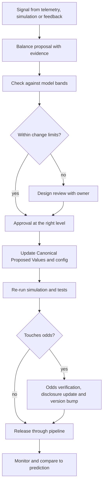

# Balance Update Process

How stats, abilities, costs, rewards, odds and economy values are changed after launch (and during beta). Balance changes are evidence-led, bounded in size, approved at the right level, verified and explained to players. The method for building the original numbers is in [[Balancing Methodology]]; this document covers changing them.

> [!info] PROPOSED
> The process and the change limits below are **PROPOSED**. The compensation policy after nerfs is **UNDECIDED** (Q-1107).

## What counts as a balance change

| Change type | Examples | Source of truth |
|---|---|---|
| Animal stats | HP, ATK, DEF, attack speed, species tweak | [[Animal Statistics Database]], [[Animal Stat Budget Model]] |
| Abilities | Damage percentage, cooldown, duration, targeting | [[Animal Abilities Catalogue]], [[Abilities and Cooldowns]] |
| Player combat | Combo, specials, Strength curve | [[Player Combat]], [[Player Strength]] |
| Wild and boss tuning | HP and ATK multipliers, leash, respawn | [[Wild Animal AI]], [[Boss Design Overview]] |
| Economy | Cash rewards, roll price, merge fees, module and station costs, multipliers | [[Canonical Proposed Values]], [[Cost Tables]] |
| Odds | Egg-rarity table, pool weights, luck slopes and pivot | [[Dynamic Luck Probability Tables]], [[Hatch Pool Tables]] |
| Ascension | Duplicate requirements, fees, per-level gains | [[Ascension Progression Table]] |

## Evidence sources

1. **Telemetry**: Cash per hour per region, win rates against bosses, pick rates of animals in teams, raid outcomes, progression distribution ([[Service - AnalyticsAndLoggingService]]).
2. **Simulation**: [[Balance Simulation Plan]] and [[Expected Value Calculations]] re-run with the proposed change.
3. **Analysis**: [[Progression Bottleneck Analysis]], [[Inflation and Farming Exploit Risks]], [[Ascension Expected Value Analysis]].
4. **Player feedback**: summarised by theme, never used alone to justify an economy change.

A proposal must cite at least one quantitative source (telemetry or simulation).

## Process

1. **Proposal.** Written on [[Template - Update]] with current value, proposed value, evidence, predicted effect and affected players.
2. **Model check.** Animal changes must keep the Power Index inside the role band and species tweaks inside their limit ([[Canonical Proposed Values#3. Animal stat model (PROPOSED)]]).
3. **Change limits.** See below. Larger changes need a design review with the owner.
4. **Approval.** See the approval matrix.
5. **Single source update.** The canonical page changes first; config is regenerated from it ([[Configuration Modules]]).
6. **Verification.** Simulation re-run; affected test cases re-run; for odds, the full odds-change process.
7. **Release.** Through the [[Content Update Pipeline]], standard or config-only lane.
8. **Follow-up.** Compare the observed effect to the prediction during the monitoring window. Record the result in the update document.

## Change limits (PROPOSED)

These are local **PROPOSED** values, not yet in [[Canonical Proposed Values]].

| Change | Limit per update without a design review |
|---|---|
| A single animal's HP, ATK or DEF | ±15% |
| A single ability's damage or heal percentage | ±20% |
| An ability cooldown | ±25% |
| Any Cash price or fee | ±20% |
| Any Cash reward | ±20% |
| Odds or pool weights | **No limit-free change.** Every odds change needs owner approval and odds sign-off regardless of size |

Rules of thumb:
- Prefer buffing under-used animals over nerfing popular ones.
- Prefer changing costs and rewards over changing odds.
- Never nerf and buff the same value in consecutive updates; wait for data.

## Approval matrix

| Change | Approver |
|---|---|
| Within limits, single animal or ability | Economy and Progression Designer with Combat Designer |
| Beyond limits, or role-wide | Owner after design review |
| Economy-wide (roll price, region multipliers, sinks) | Owner |
| Any odds change | Owner plus odds sign-off (authority **UNDECIDED**, Q-1117) |
| Changes to **CONFIRMED** rules (team size, storage start, merge ratio, theft cap) | Not a balance change. Requires a new owner decision in the [[Decision Register]] |

## Nerfs and long-term investment

Ascension and merging represent long-term player investment. A nerf to an ascended animal can feel like losing what was earned (R-038 in [[Risk Register]]).

- Explain every nerf in patch notes with the reason and evidence class.
- Avoid nerfs within a short period after an animal's release unless it breaks the game.
- Never retroactively change ascension levels already reached.

> [!warning] UNDECIDED (Q-1107)
> Compensation after a nerf. Options: (A) none; (B) refund the consumed duplicates or fees when a nerf exceeds the change limits; (C) a one-time free re-allocation (for example a re-select of which animal to ascend). **Recommendation (PROPOSED):** B for nerfs beyond the limits, A otherwise. Any compensation is granted from an audit, never by guesswork.

## Economy adjustments

- Any change to Cash sources or sinks must be checked for inflation with the cash-per-hour model per region.
- Price reductions are safe to ship quickly; price increases need advance notice.
- Never adjust a price so that a player who already paid is disadvantaged retroactively.
- Storage expansion pricing stays **UNDECIDED** until decided ([[Open Questions#Q-010]]).

## Odds changes

Odds changes are the most sensitive balance change.

> [!danger] Compliance
> - Announce in advance; show new odds on every roll and hatch surface from the moment they apply.
> - Bump the odds-table version; reject stale `oddsVersion` tokens (D-041).
> - Re-verify with [[Statistical Testing of Probabilities]].
> - Never apply new odds to a roll or hatch already committed (D-017 **CONFIRMED**).
> - Never introduce pity, duplicate protection or bias towards unowned animals (D-018 **CONFIRMED**).

## Related documents
- [[Live Operations Index]]
- [[Live Operations Framework]]
- [[Balancing Methodology]]
- [[Balance Simulation Plan]]
- [[Content Update Pipeline]]
- [[Versioning and Changelog Policy]]
- [[Canonical Proposed Values]]
- [[Probability Balancing]]
