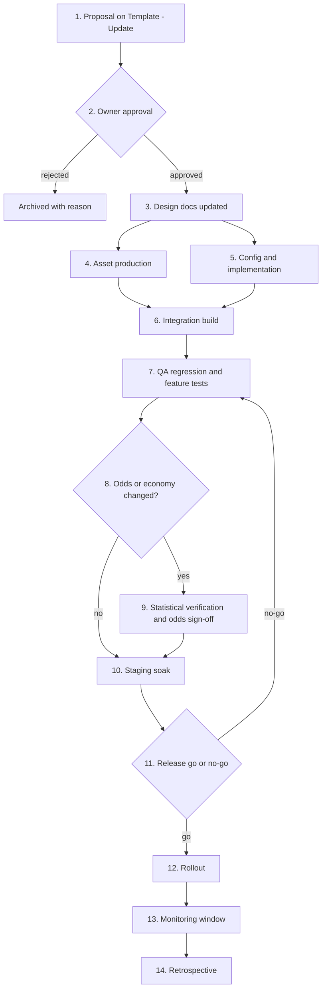
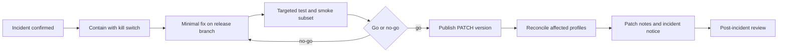

# Content Update Pipeline

The path every post-launch change takes from idea to retrospective. There are three lanes: the **standard lane** for content, balance and economy updates, the **config-only lane** for changes that need no new game build, and the **hotfix lane** for urgent fixes. Update classes are defined in [[Live Operations Framework#Update classes]].

> [!info] PROPOSED
> The pipeline is a **PROPOSED** process. The test environment structure is **UNDECIDED** (Q-1109) and the server rollout method is **UNDECIDED** (Q-1115).

## Standard lane

| Stage | What happens | Exit criterion | Owner |
|---|---|---|---|
| 1. Proposal | The update is written on [[Template - Update]]: goal, contents, affected systems, odds impact, economy impact, data migration, risks | Template complete | Proposer |
| 2. Approval | Owner approves scope; Production Manager confirms capacity | Approval recorded in the update document | Project owner |
| 3. Design docs | Owning documents created or updated (animal, boss, region, egg, module); new values added to [[Canonical Proposed Values]] | Docs reviewed | Designer |
| 4. Asset production | Models, rigs, animations, VFX and audio registered in [[Asset Register]] | Art and audio review passed | Art Director, Audio Lead |
| 5. Config and implementation | Config modules updated; any code change follows [[Luau Coding Standards]]; data migrations written ([[Data Validation and Migration]]) | Code review passed | Lead Engineer |
| 6. Integration build | Content and code merged into a release candidate; version numbers assigned ([[Versioning and Changelog Policy]]) | Build boots and passes smoke tests | Lead Engineer |
| 7. QA | Feature tests for the new content plus regression ([[Test Plan Matrix]]) | No open top-severity defects | QA Lead |
| 8–9. Odds and economy | If any random outcome, pool, luck input or price changed: sum checks, sampling tests, parity check, odds sign-off (authority **UNDECIDED**, Q-1117) | Signed verification record | QA Lead, Economy and Progression Designer |
| 10. Staging soak | The release candidate runs in the test environment with production-like load; migrations tested on copies of real profile shapes | No data errors; benchmarks within targets | QA Lead |
| 11. Go or no-go | Release checklist reviewed line by line ([[Versioning and Changelog Policy#Release checklist]]) | Every line ticked or the release is no-go | Live Operations Director |
| 12. Rollout | Publish; servers move to the new version by the agreed method (Q-1115); odds-table switch happens with the build | New version live | Lead Engineer |
| 13. Monitoring | Watch the metrics in [[Live Operations Framework#Health monitoring]] with extra attention to anything the update touched | Window closes without rollback, or a rollback or hotfix is executed | Live Operations Director |
| 14. Retrospective | What went well, what slipped, new test cases, risk register updates | Notes attached to the update document | Production Manager |

### Shipping content dormant

Large content can be built into the game behind a disabled config flag and enabled later through the config-only lane. Rules:
- Dormant content must not be reachable, visible or data-mined into an advantage; its odds tables must not be selectable by any remote while disabled.
- Enabling dormant content that touches odds is still an odds change: verification, disclosure, version bump and advance notice all apply.

## Config-only lane

For changes that touch only configuration values with no new game build: kill switches, event toggles, spawn timers, event multipliers.

1. Change proposed with the exact old and new values.
2. Config validation runs (types, ranges, pool sums).
3. If the change touches odds or prices, stages 8–9 of the standard lane apply in full, and the odds-table version bumps.
4. Live Operations Director approves; for odds or prices, the odds sign-off also applies.
5. Change applied; config version increments; the change is logged in the update record and the [[Changelog]] release entry.

How servers pick up live config without a new build (polling a data store, MessagingService broadcast, or a mix) is designed in [[Configuration Modules]]; propagation timing is *unverified* until measured.

## Hotfix lane

The hotfix lane exists for top-severity issues: exploits, data loss or duplication, purchase faults, odds faults and crashes ([[Bug Reporting and Severity]]).

Rules:
- **Smallest possible change.** No content, balance or refactoring rides along with a hotfix.
- **Contain first.** A kill switch is preferred to a rushed fix.
- **Minimum test set:** the test that reproduces the bug, plus [[Test Cases - Persistence]] smoke and [[Test Cases - Exploit Prevention]] smoke, plus [[Test Cases - Egg Rolls and Hatching]] smoke if the fix is anywhere near rolls or hatches.
- **Odds are never changed in a hotfix** unless the hotfix exists to correct an odds fault; then the corrected table is verified, disclosed and versioned like any other odds change.
- **Response targets** are in [[Live Operations Framework#Incident response]].

## Rollback

- Keep the previous release candidate ready to republish. Reverting a place to an earlier published version is a Roblox feature the team should confirm in documentation before relying on it (*unverified* in this vault; see [[Roblox Platform References]]).
- **Code can be rolled back; data cannot.** Every data migration must be readable by the previous game version for one release (**PROPOSED** rule): new fields are additive and old versions ignore them.
- Rolling back odds means reverting to the previous odds-table version with a new version number, never silently restoring an old number.

## Release environments

| Environment | Purpose | Data |
|---|---|---|
| Development | Day-to-day work | Test data stores only |
| Test or staging | Release candidates, soaks, migrations | Isolated from production (structure **UNDECIDED**, Q-1109) |
| Production | Players | Production data stores |

## Related documents
- [[Live Operations Index]]
- [[Live Operations Framework]]
- [[Content Expansion Guidelines]]
- [[Versioning and Changelog Policy]]
- [[Balance Update Process]]
- [[Template - Update]]
- [[M23 - Live Updates]]
- [[Definition of Done]]
