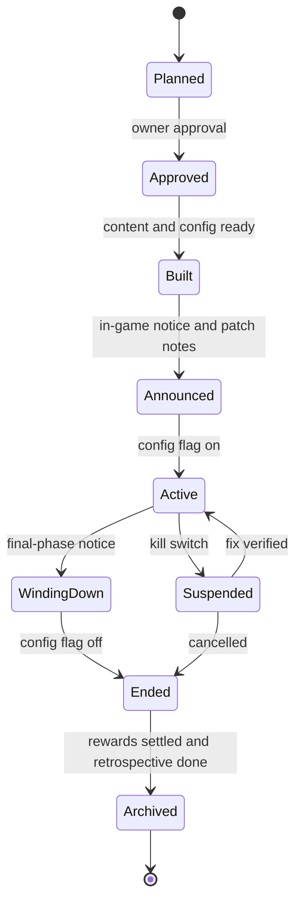

# Seasonal and Limited-Time Events

Rules and formats for seasonal content and limited-time events. Events give players a reason to return and a shared moment in the world. They must never be required to progress, never create paid pressure, and never weaken odds disclosure.

> [!info] PROPOSED
> All event formats here are **PROPOSED**. Several structural questions are **UNDECIDED**: permanence of limited-time content (Q-1105), seasonal progression tracks (Q-1112), event currency (Q-1113) and event eggs (Q-1114). No event dates or durations are set in this vault.

## Event principles

1. **Additive, not required.** Missing an event never blocks progression or leaves a player permanently weaker in PvP or raids.
2. **Fair to free players.** Every event reward that affects power can be earned without Robux (D-027 **CONFIRMED**).
3. **Odds stay honest.** Any event that changes a random outcome follows the full odds-change process: disclosure before commit, verification, odds-table version bump and advance notice ([[Content Expansion Guidelines#Adding an animal without breaking hatch pools]]).
4. **Luck stays separate from encounters.** Hidden progression luck never affects wild encounter rarity (D-017). An event may change a spawn table only if the change is announced and applies equally to every player in the server; it is never tied to an individual's luck.
5. **No surprise expiry of owned items.** Anything a player owns stays owned after the event.
6. **Events end cleanly.** Every event defines in advance what happens to its currency, eggs, decorations and progress at the end.
7. **Evergreen first.** Events season the game; they are not its main source of fun ([[Live Operations Framework#Evergreen principle]]).

## Event formats

| Format | Description | Touches odds? | Main risks | Status |
|---|---|---|---|---|
| **Seasonal dressing** | Hub and region decoration, seasonal music and ambience, cosmetic base decorations | No | Performance budget | **PROPOSED** |
| **Boss surge** | World bosses spawn more often for a period; announced server-wide | No (boss rewards follow [[Open Questions#Q-015]]) | Inflation if rewards stack | **PROPOSED** |
| **Rare-spawn festival** | Higher chance of Mythical and Secret rare-spawn windows, equal for all players, announced | Changes wild spawn chances, not egg odds; must be disclosed as an event rule | Inflation; perceived unfairness if not announced | **PROPOSED** |
| **Community goal** | Server or game-wide target (for example total world boss defeats) unlocks a cosmetic for everyone who took part | No | Low | **PROPOSED** |
| **Cash event** | Temporary Cash bonus on wild defeats | No, but shifts economy | Inflation; must not be sold for Robux (D-044 **PROPOSED**) | **PROPOSED** |
| **Limited-time variant** | A variant obtainable during the event | Yes if random | Depends on [[Open Questions#Q-006]] and Q-1105 | **UNDECIDED** |
| **Event egg** | A themed egg with its own rarity table and pools | Yes | Disclosure, storage, raids, merging | **UNDECIDED** (Q-1114) |
| **Seasonal track** | A progression track of event rewards | Only if any reward is random | Paid-tier pressure | **UNDECIDED** (Q-1112) |

## Event lifecycle

| State | Required before entering it |
|---|---|
| Approved | Event plan on [[Template - Update]] with format, rewards, odds impact, economy impact, end-of-event rules |
| Built | Content tested; event odds tables (if any) verified and signed |
| Announced | Players told what the event is, what it changes, and how it ends |
| Active | Config flag on; odds-table version bumped if any odds changed; monitoring watching event metrics |
| WindingDown | Clear notice that the event is ending, shown to all players who log in |
| Ended | Flag off; event currency handled by the pre-agreed rule; odds return to the standard table with a new version number |
| Archived | Reward audit complete; retrospective attached to the update record |

## Event eggs, if approved

> [!warning] UNDECIDED (Q-1114)
> Whether time-limited egg types exist at all. If they are approved, each one must define, before it is built:
> - Its egg-rarity table and every hatch pool, disclosed before commit and verified like standard eggs.
> - Whether it can be **merged** (and into what), whether it is **stealable** when stored in the base (backpack eggs are never stealable, **CONFIRMED**), and whether it counts towards the 60-egg starting storage.
> - What happens to unhatched event eggs after the event ends. **Recommendation (PROPOSED):** they stay hatchable forever, with their own pool frozen and disclosed.

## Event currency, if approved

> [!warning] UNDECIDED (Q-1113)
> Options: (A) no event currency, rewards granted directly; (B) an event currency that converts to Cash at the end; (C) an event currency that expires. **Recommendation (PROPOSED):** A or B. Option C creates loss aversion pressure that conflicts with principle 5. No event currency may be bought with Robux if it can be spent on random outcomes, unless the paid-random-item requirements are met ([[Roblox Monetisation Policy Requirements]]).

## Limited-time content permanence

> [!warning] UNDECIDED (Q-1105)
> Can limited-time animals or variants become permanently unobtainable? Options: (A) never, everything returns in a later event or joins a permanent pool; (B) cosmetic items may be permanently limited, power-affecting items may not; (C) anything may be permanently limited. **Recommendation (PROPOSED):** B, to protect fairness and the "fully playable without Robux" principle while still allowing collectable cosmetics.

## Seasonal tracks

> [!warning] UNDECIDED (Q-1112)
> Whether a seasonal progression track exists, and whether any paid tier is allowed. Any paid tier must give no exclusive power, and any random reward on it would make it subject to paid-random-item rules. Monetisation principles: [[Monetisation Principles]].

## Economy guard rails for events

- Every event with an economy effect has its Cash impact estimated with [[Expected Value Calculations]] before approval.
- Events with Cash or reward multipliers do not stack with each other unless the plan says so explicitly.
- Post-event, compare actual against estimated impact; feed the result into [[Balance Update Process]].

## Testing

- Event content: feature-specific test cases (for example [[Test Cases - Bosses]] for a boss surge).
- Any odds change: [[Statistical Testing of Probabilities]] and [[Test Cases - Egg Rolls and Hatching]].
- Start and end transitions: test that flags flip cleanly on live servers and that end-of-event rules apply to players who are offline at the end.
- [[Test Cases - Mobile Performance]] for seasonal dressing.

## Related documents
- [[Live Operations Index]]
- [[Live Operations Framework]]
- [[Content Expansion Guidelines]]
- [[Content Update Pipeline]]
- [[Balance Update Process]]
- [[Randomised Reward Compliance]]
- [[Monetisation Principles]]
- [[Template - Update]]
