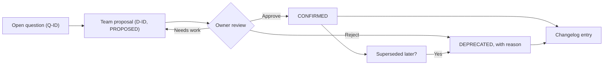

# Decisions Index

Governance for every game decision. The project owner has final authority ([[CLAUDE]] rules apply to all editors).

| Document | Purpose |
|---|---|
| [[Decision Register]] | Master list of decisions: 29 **CONFIRMED** owner decisions and 16 **PROPOSED** team recommendations |
| [[Open Questions]] | Every **UNDECIDED** item, with a Q- ID and its blocking level |
| [[Changelog]] | A dated record of changes to the vault and to decisions |

## Decision lifecycle

## Status vocabulary

| Status | Meaning |
|---|---|
| **CONFIRMED** | Explicitly decided by the project owner |
| **PROPOSED** | A team recommendation that may be prototyped but is not final |
| **UNDECIDED** | An open question; options may be documented, but no answer is chosen |
| **DEPRECATED** | Superseded; kept for history, with a link to the replacement |

## Owner review queue (highest impact first)

| Question | Why it matters |
|---|---|
| [[Open Questions#Q-012]] raid duration and [[Open Questions#Q-013]] egg theft limit | Raids cannot reach beta without them |
| [[Open Questions#Q-011]] PvP activation method | PvP prototype is blocked |
| [[Open Questions#Q-014]] defeat penalties | Shapes risk and reward for the whole combat loop |
| [[Open Questions#Q-009]] storage expansion currency | Economy and monetisation dependency |
| [[Open Questions#Q-023]] hatch timing | Hatch prototype is blocked |
| [[Open Questions#Q-033]] which animals defend | Raid prototype is blocked |
| [[Open Questions#Q-027]] ancient lineage theme | Art production of Mythical and Secret animals |

## Related documents

[[Home]] · [[Design Dashboard]] · [[Template - Decision]]
