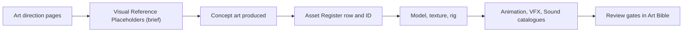

# Assets Index

This folder is the production catalogue for art assets: what exists or must be made, how it is named, and which concept images are still needed. Style and quality rules live in [[Art Direction Index]]; this folder tracks the assets themselves.

> [!info] PROPOSED
> All asset specifications are production proposals. Asset ID prefixes come from the vault rules (`CLAUDE.md` §9). Animation, VFX, sound and music IDs are catalogued by their own disciplines ([[Animation Bible]], [[VFX Bible]], [[Sound Bible]], [[Music Direction]]).

## Documents

| Document | What it covers |
|---|---|
| [[Asset Register]] | Master table of 60 animals, 7 eggs, 12 bosses, 9 base module assets, 22 environment kits, 22 UI kits and 5 variant material sets, with dimensions, structure, materials, textures, colours, lighting, pointers to animation, VFX and sound, budgets and production priority |
| [[Asset Naming Conventions]] | Asset ID rules, file-name grammar, Roblox upload names, Studio instance names, attributes, tags, folder structure and validation |
| [[Visual Reference Placeholders]] | Labelled briefs for every concept image still needed (style frames, turnarounds, eggs, regions, bases, bosses, UI); no stock or fake images |

## Concept Images folder

`27 - ASSETS AND VISUAL REFERENCES/Concept Images/` holds original diagrams drawn as SVG for this vault. They illustrate **PROPOSED** specifications and are not final art.

| File | Content | Embedded in |
|---|---|---|
| `Rarity Colour Swatch Sheet.svg` | Seven rarity keys with pips and badge shapes | [[Colour Palette]], [[Rarity Visual Language]], [[Visual Reference Placeholders]] |
| `Seven Egg Silhouette Lineup.svg` | Egg silhouette ladder EGG-01 to EGG-07 at relative scale | [[Egg Art Direction]], [[Visual Reference Placeholders]] |
| `Title Treatment - Fight Animals for Eggs.svg` | Title treatment concept added by another contributor (marked in-file as a placeholder, not a final logo) | [[Home]] |

## Quick orientation

## Related documents
- [[Art Direction Index]]
- [[Art Bible]]
- [[Animation and VFX Index]]
- [[Sound Design Index]]
- [[Vault Map]]
